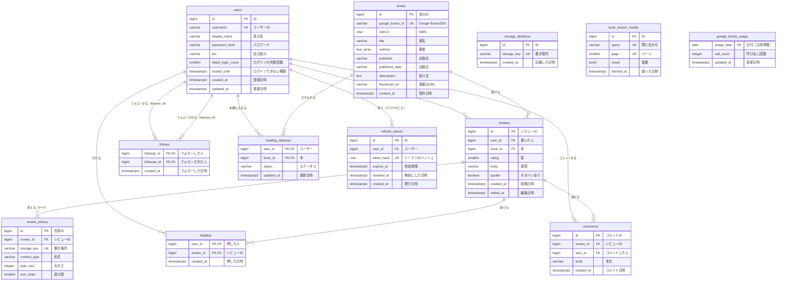

# データ設計書：読書記録アプリ（BookLog）

| 項目 | 内容 |
| --- | --- |
| 文書番号 | BL-BD-DATA |
| 版数 | 0.1 |
| 作成日 | 2026-11-02 |
| 最終更新日 | 2026-11-02 |
| 作成者 | （氏名） |
| 上位文書 | [基本設計書](basic-design.md)（BL-BD） |
| 元にした文書 | [データ要件定義書](../requirements/data-requirements.md)（BL-REQ-DATA）版数 0.2、[機能定義書](../functions/function-definition.md)（BL-FD）版数 0.1、[技術スタック定義書](../tech-stack.md)（BL-TECH）版数 0.1 |
| 状態 | 承認待ち |

## 改訂履歴

| 版数 | 日付 | 内容 | 作成者 |
| --- | --- | --- | --- |
| 0.1 | 2026-11-02 | 初版。構成は Raise timeline のデータ設計書と同じにした | （氏名） |

本書は基本設計書の一部である。承認は[基本設計書](basic-design.md)で一括して行う。表記のルールは基本設計書 1.3 のとおり。

データベースは PostgreSQL（要件定義書 P-1）とし、型は PostgreSQL の型で書く。バージョンは[技術スタック定義書](../tech-stack.md)のとおり。テーブルは Flyway のマイグレーションで作る。

---

## 1. 方針

| No | 方針 | 理由 |
| --- | --- | --- |
| 1 | 第 3 正規形を基本とする。参考になった数・コメント数・フォロー数・フォロワー数・レビュー数・平均評価・本棚の冊数は列に持たず、その都度数える | 同じデータを 2 か所に持たないことで、食い違いを防ぐ。件数は 6 章の索引で速く数えられる |
| 2 | 各データの ID は、データベースが自動で付ける連番（bigint）とする | レビューの ID の大きさで新しい順に並べ、「この ID より古いもの」で読み込む（T-2・T-7）。データはログインした全員に公開するため（要件定義書 3.1）、ID を推測されても困らない。他人のデータを変えられないことは BR-7 で守る |
| 3 | 削除は、データを実際に消す方式（物理削除）とする | 「元に戻す」機能がないため。退会では、その人のデータをすぐに消す（要件定義書 U-4） |
| 4 | 日時はタイムゾーン付き（timestamptz）で保存し、画面では日本時間で出す | 海外のサーバーを使っても時刻がずれないようにするため |
| 5 | 写真のファイルは S3 に置き、データベースには置き場所（キー）だけを持つ。本の表紙は Google Books の URL だけを持つ | 要件定義書 P-2・P-3。データベースを小さく保つ |
| 6 | 参考になった・フォロー・読書ステータスの表は、2 つの ID の組み合わせを主キーにする。レビューは (user_id, book_id) を一意にする | 「1 人 1 レビューに 1 つ」（H-3）「同じ人を 2 回フォローしない」（F-4）「1 冊に 1 つのステータス」（ST-2）「1 人 1 冊 1 レビュー」（RV-1）をデータベースで守る |
| 7 | ユーザーに結びつくデータは、外部キーの ON DELETE CASCADE で、ユーザーを消すと一緒に消えるようにする | 退会（A-12）を 1 つの DELETE で漏れなく行うため |
| 8 | Google Books API の検索の結果と、その日の呼び出し回数も PostgreSQL に置く | API のタスクを止めても作り直しても残るようにするため（技術スタック定義書 5.3） |

## 2. エンティティ一覧

| 論理名 | 物理名 | 内容 | 件数の目安 |
| --- | --- | --- | --- |
| ユーザー | users | 登録した人 | 1,000 件 |
| 本 | books | Google Books API から取り込んだ本 | 5,000 件 |
| レビュー | reviews | 本への星と感想 | 1 万件 |
| 写真 | review_photos | レビューに添えた写真の置き場所 | 1 レビューに 0〜4 件。合計 7,000 件 |
| 参考になった | helpfuls | 誰がどのレビューに付けたか | 5 万件 |
| コメント | comments | レビューへのコメント | 3 万件 |
| フォロー | follows | 誰が誰をフォローしているか | 5 万件 |
| 読書ステータス | reading_statuses | 誰がどの本に、どのステータスを付けたか（本棚） | 3 万件 |
| リフレッシュトークン | refresh_tokens | ログインしたままにするためのトークン（N-19） | ログインしているブラウザの数。2,000 件ほど |
| S3 から消せなかったファイル | storage_deletions | レビューの削除・写真の取り外し・退会のときに S3 から消せなかったファイルの置き場所（BR-5） | ふだんは 0 件 |
| 書籍検索の結果 | book_search_results | Google Books API の検索の結果を 24 時間使い回すための写し（B-9） | 1 日に多くて 1,000 件 |
| Google Books API の呼び出し回数 | google_books_usage | 日ごとの呼び出し回数（B-8） | 1 日 1 件 |

件数の目安は、要件定義書 11.1 の性能を測る条件と同じにした。

## 3. ER 図



線の記号の意味：`||` はちょうど 1、`o{` は 0 以上。follows は users と 2 本の線でつながる（フォローする側とされる側）。storage_deletions・book_search_results・google_books_usage は、ほかの表とつながない。books の authors は text[]（文字列の配列）である（Mermaid では text_array と書いた）。book_search_results の UK は (query, page) の組み合わせで一意という意味である。

## 4. テーブル定義

### 4.1 ユーザー（users）

| No | 論理名 | 物理名 | 型 | 必須 | キー | 初期値 | 説明 |
| --- | --- | --- | --- | --- | --- | --- | --- |
| 1 | ID | id | bigint | ○ | 主キー | 自動の連番 | 画面には出さない |
| 2 | ユーザー ID | username | varchar(15) | ○ | 一意（lower(username)） | | 登録したときの大文字・小文字のまま保存し、重複は小文字にして確かめる（A-2） |
| 3 | 表示名 | display_name | varchar(30) | ○ | | | |
| 4 | パスワード | password_hash | varchar(100) | ○ | | | BCrypt のハッシュ（N-14） |
| 5 | 自己紹介 | bio | varchar(160) | ○ | | 空文字 | 自己紹介がない状態は空文字 1 種類で表す |
| 6 | ログインの失敗回数 | failed_login_count | smallint | ○ | | 0 | A-7 |
| 7 | ログインできない期限 | locked_until | timestamptz | | | なし | 5 回続けて失敗した時刻の 15 分後（A-7） |
| 8 | 登録日時 | created_at | timestamptz | ○ | | 登録した時刻 | |
| 9 | 更新日時 | updated_at | timestamptz | ○ | | 更新した時刻 | |

### 4.2 本（books）

| No | 論理名 | 物理名 | 型 | 必須 | キー | 初期値 | 説明 |
| --- | --- | --- | --- | --- | --- | --- | --- |
| 1 | 本の ID | id | bigint | ○ | 主キー | 自動の連番 | 本のページの URL（/books/{id}）に使う |
| 2 | Google Books の ID | google_books_id | varchar(40) | ○ | 一意 | | 同じ本を 1 つにまとめる（B-6） |
| 3 | ISBN | isbn13 | char(13) | | | なし | 13 桁の数字（FN-02 の 5 章の 4）。同じ ISBN の本が Google Books に 2 つあることがあるため、一意にはしない |
| 4 | 書名 | title | varchar(500) | ○ | | | 「title subtitle」（FN-02 の 5 章の 3）。長すぎるときは BR-11 で切る |
| 5 | 著者 | authors | text[] | ○ | | 空の配列 | API が返した順。BR-11 で数と長さを切る |
| 6 | 出版社 | publisher | varchar(200) | | | なし | |
| 7 | 出版日 | published_date | varchar(10) | | | なし | 「2024」「2024-05」「2024-05-10」のどれか |
| 8 | 紹介文 | description | text | | | なし | HTML のタグを取り除いたもの（FN-02 の 5 章の 6） |
| 9 | 表紙の URL | thumbnail_url | varchar(500) | | | なし | https にそろえる（FN-02 の 5 章の 5） |
| 10 | 保存日時 | created_at | timestamptz | ○ | | 取り込んだ時刻 | |

本は、取り込んだ後は変えず、消さない（要件定義書 P-4、データ要件定義書 2 章）。

### 4.3 レビュー（reviews）

| No | 論理名 | 物理名 | 型 | 必須 | キー | 初期値 | 説明 |
| --- | --- | --- | --- | --- | --- | --- | --- |
| 1 | レビュー ID | id | bigint | ○ | 主キー | 自動の連番 | 新しいレビューほど大きい。並び順と読み込みの位置に使う |
| 2 | 書いた人 | user_id | bigint | ○ | 外部キー（users）・一意（book_id と組み合わせ） | | 1 人 1 冊 1 つ（BR-2） |
| 3 | 本 | book_id | bigint | ○ | 外部キー（books） | | |
| 4 | 星 | rating | smallint | ○ | | | 1〜5（CHECK 制約） |
| 5 | 感想 | body | varchar(2000) | ○ | | | トリム後 1 文字以上（API で確かめる）。PostgreSQL の varchar(n) は文字（コードポイント）で数えるので、画面・API と数え方が合う |
| 6 | ネタバレあり | spoiler | boolean | ○ | | false | RV-11 |
| 7 | 投稿日時 | created_at | timestamptz | ○ | | 投稿した時刻 | 編集しても変えない |
| 8 | 編集日時 | edited_at | timestamptz | | | なし | 最後に編集した時刻。「（編集済み）」を出すかどうかに使う（RV-10） |

### 4.4 写真（review_photos）

| No | 論理名 | 物理名 | 型 | 必須 | キー | 初期値 | 説明 |
| --- | --- | --- | --- | --- | --- | --- | --- |
| 1 | 写真 ID | id | bigint | ○ | 主キー | 自動の連番 | |
| 2 | レビュー ID | review_id | bigint | ○ | 外部キー（reviews） | | |
| 3 | 置き場所 | storage_key | varchar(100) | ○ | 一意 | | S3 のキー。「reviews/{UUID}.{拡張子}」。元のファイル名は使わない |
| 4 | 形式 | content_type | varchar(20) | ○ | | | image/jpeg・image/png・image/webp のどれか |
| 5 | 大きさ | byte_size | integer | ○ | | | 1〜5,242,880 |
| 6 | 並び順 | sort_order | smallint | ○ | 一意（review_id と組み合わせ。トランザクションの終わりで確かめる） | | 0〜3（CHECK 制約）。編集で並べ直すときに途中で重ならないよう、一意の制約は DEFERRABLE INITIALLY DEFERRED にする |

### 4.5 参考になった（helpfuls）

| No | 論理名 | 物理名 | 型 | 必須 | キー | 初期値 | 説明 |
| --- | --- | --- | --- | --- | --- | --- | --- |
| 1 | 押した人 | user_id | bigint | ○ | 主キー（第 1 列）・外部キー（users） | | レビューを書いた本人は押せない（API で確かめる。BR-15） |
| 2 | レビュー ID | review_id | bigint | ○ | 主キー（第 2 列）・外部キー（reviews） | | |
| 3 | 押した日時 | created_at | timestamptz | ○ | | 押した時刻 | |

### 4.6 コメント（comments）

| No | 論理名 | 物理名 | 型 | 必須 | キー | 初期値 | 説明 |
| --- | --- | --- | --- | --- | --- | --- | --- |
| 1 | コメント ID | id | bigint | ○ | 主キー | 自動の連番 | 古い順に並べるのに使う |
| 2 | レビュー ID | review_id | bigint | ○ | 外部キー（reviews） | | |
| 3 | コメントした人 | user_id | bigint | ○ | 外部キー（users） | | |
| 4 | 本文 | body | varchar(500) | ○ | | | トリム後 1 文字以上 |
| 5 | コメント日時 | created_at | timestamptz | ○ | | コメントした時刻 | |

### 4.7 フォロー（follows）

| No | 論理名 | 物理名 | 型 | 必須 | キー | 初期値 | 説明 |
| --- | --- | --- | --- | --- | --- | --- | --- |
| 1 | フォローした人 | follower_id | bigint | ○ | 主キー（第 1 列）・外部キー（users） | | |
| 2 | フォローされた人 | followee_id | bigint | ○ | 主キー（第 2 列）・外部キー（users） | | follower_id と同じ値は入れられない（CHECK 制約。F-3） |
| 3 | フォローした日時 | created_at | timestamptz | ○ | | フォローした時刻 | G-10 の並び順 |

### 4.8 読書ステータス（reading_statuses）

| No | 論理名 | 物理名 | 型 | 必須 | キー | 初期値 | 説明 |
| --- | --- | --- | --- | --- | --- | --- | --- |
| 1 | ユーザー | user_id | bigint | ○ | 主キー（第 1 列）・外部キー（users） | | |
| 2 | 本 | book_id | bigint | ○ | 主キー（第 2 列）・外部キー（books） | | |
| 3 | ステータス | status | varchar(10) | ○ | | | WANT（読みたい）・READING（読書中）・READ（読了）のどれか（CHECK 制約） |
| 4 | 更新日時 | updated_at | timestamptz | ○ | | 付けた時刻 | ステータスを変えたときに更新する。同じステータスのときは変えない（FN-08 の 5 章の 3）。本棚の並び順 |

ステータスを外したら行を消す（ST-3）。

### 4.9 リフレッシュトークン（refresh_tokens）

| No | 論理名 | 物理名 | 型 | 必須 | キー | 初期値 | 説明 |
| --- | --- | --- | --- | --- | --- | --- | --- |
| 1 | ID | id | bigint | ○ | 主キー | 自動の連番 | |
| 2 | ユーザー | user_id | bigint | ○ | 外部キー（users） | | |
| 3 | トークンのハッシュ | token_hash | char(64) | ○ | 一意 | | トークン（32 バイトの乱数）の SHA-256 を 16 進数にしたもの。トークンそのものは保存しない |
| 4 | 有効期限 | expires_at | timestamptz | ○ | | 発行した時刻の 14 日後 | A-8 |
| 5 | 無効にした日時 | revoked_at | timestamptz | | | なし | 取り直しで新しいものに替えたとき・ログアウトしたときに入れる。「無効にしたものが使われた」ことを見分けるため、すぐには消さない（BR-9） |
| 6 | 発行日時 | created_at | timestamptz | ○ | | 発行した時刻 | |

アクセストークン（JWT）はデータベースに保存しない（署名で確かめるため。機能定義書 3.2）。

### 4.10 S3 から消せなかったファイル（storage_deletions）

| No | 論理名 | 物理名 | 型 | 必須 | キー | 初期値 | 説明 |
| --- | --- | --- | --- | --- | --- | --- | --- |
| 1 | ID | id | bigint | ○ | 主キー | 自動の連番 | |
| 2 | 置き場所 | storage_key | varchar(100) | ○ | 一意 | | S3 のキー（reviews/…） |
| 3 | 記録した日時 | created_at | timestamptz | ○ | | 記録した時刻 | |

ほかの表とは外部キーでつながない（行が消えた後のファイルを記録するため）。1 日 1 回（4:30）S3 から消し直し、消せたら行を消す（BR-5）。

### 4.11 書籍検索の結果（book_search_results）

| No | 論理名 | 物理名 | 型 | 必須 | キー | 初期値 | 説明 |
| --- | --- | --- | --- | --- | --- | --- | --- |
| 1 | ID | id | bigint | ○ | 主キー | 自動の連番 | |
| 2 | 問い合わせ | query | varchar(110) | ○ | 一意（page と組み合わせ） | | 「isbn:9784101010014」か「q:夏目漱石」。BR-12 の形にそろえたもの |
| 3 | ページ | page | smallint | ○ | | | 1〜5 |
| 4 | 結果 | result | jsonb | ○ | | | 画面に返す形（FN-02 の 6 章の items と hasNext）に直したもの |
| 5 | 取った日時 | fetched_at | timestamptz | ○ | | 取った時刻 | 24 時間以内なら使い回す（B-9） |

### 4.12 Google Books API の呼び出し回数（google_books_usage）

| No | 論理名 | 物理名 | 型 | 必須 | キー | 初期値 | 説明 |
| --- | --- | --- | --- | --- | --- | --- | --- |
| 1 | 日付 | usage_date | date | ○ | 主キー | | 日本時間の日付（FN-02 の 5 章の 8） |
| 2 | 呼び出し回数 | call_count | integer | ○ | | 0 | 0〜1,000（CHECK 制約）。検索と 1 冊の取り込みの両方を数える |
| 3 | 更新日時 | updated_at | timestamptz | ○ | | 更新した時刻 | |

## 5. リレーションシップ定義

| 親 | 子 | 多重度 | 親を削除したときの子 | 説明 |
| --- | --- | --- | --- | --- |
| ユーザー | レビュー・参考になった・コメント・フォロー（両方の列）・読書ステータス・リフレッシュトークン | 1 対 0 以上 | 一緒に削除 | 退会（A-12。BR-14） |
| レビュー | 写真 | 1 対 0〜4 | 一緒に削除 | RV-9。S3 のファイルは API が消す（BR-5） |
| レビュー | 参考になった・コメント | 1 対 0 以上 | 一緒に削除 | RV-9 |
| 本 | レビュー・読書ステータス | 1 対 0 以上 | 削除させない（RESTRICT） | 本は消さない（4.2） |

「一緒に削除」は、外部キーの ON DELETE CASCADE で行う。

## 6. 索引

主キーと一意の制約には自動で索引ができる。それ以外に次の索引を作る。

| テーブル | 列 | 使う場面 |
| --- | --- | --- |
| reviews | (user_id, id DESC) | プロフィールのレビューの一覧と件数（PF-4）、「フォロー中」タブ（T-1） |
| reviews | (book_id, id DESC) | 本のページのレビューの一覧・件数・平均評価（BK-3・BK-5） |
| helpfuls | (review_id) | 参考になった数（H-5）、レビューを消したときの一緒の削除 |
| comments | (review_id, id) | コメントの一覧と件数（C-3） |
| comments | (user_id) | 退会のときの一緒の削除 |
| follows | (followee_id, created_at DESC) | フォロワーの一覧と件数（F-5） |
| reading_statuses | (user_id, status, updated_at DESC, book_id DESC) | 本棚の一覧と冊数（ST-4・ST-5） |
| refresh_tokens | (user_id) | その人のリフレッシュトークンをすべて無効にする（BR-9） |
| refresh_tokens | (expires_at) | 有効期限を過ぎたものをまとめて消す（BR-9） |
| book_search_results | (fetched_at) | 24 時間を過ぎたものをまとめて消す（BR-12） |

「すべて」タブ（T-1）は reviews の主キー（id）の索引を、「フォロー中」の follows は主キー（follower_id, followee_id）の索引を使う。

## 7. データのルール

| ID | ルール | 関連要件 |
| --- | --- | --- |
| BR-1 | 文字列は前後の空白を取り除き、改行を LF にそろえてから保存する。パスワードは取り除かない | A-2、A-4、RV-4、C-2、PF-7 |
| BR-2 | レビューは 1 人 1 冊に 1 つ。(user_id, book_id) の一意の制約で守り、違反したら 409 REVIEW_EXISTS を返す | RV-1 |
| BR-3 | 1 つのレビューの写真は 4 枚まで。API で確かめ、sort_order（0〜3）の一意の制約でも守る | PH-2 |
| BR-4 | レビューと写真の保存は、全部成功するか全部やめるかのどちらかにする。S3 への保存に失敗したらレビューの行を作らず（変えず）、行の保存に失敗したら S3 に置いたファイルを消す | PH-5 |
| BR-5 | レビューの削除・編集での写真の取り外し・退会では、先にデータベースから消し、コミットの後で S3 のファイルを消す。S3 から消すのに失敗したファイルは storage_deletions に記録しておき、1 日 1 回（4:30）まとめて消し直す。BR-4 で置いたファイルを消せなかったときも同じ | RV-9、PH-4、A-12、N-10 |
| BR-6 | 参考になった・フォロー・読書ステータスを重ねて登録しようとしたときは、エラーにせず「すでにある」として扱う（INSERT … ON CONFLICT）。取り消しも、ないものを消そうとしたときはエラーにしない | H-3、F-4、ST-2 |
| BR-7 | レビューの編集・削除、コメントの削除、参考になった・フォロー・読書ステータスの変更、プロフィールの変更、退会は、ログインしている本人のものだけを対象にする。これをサーバー側で確かめ、本人のものでなければ 403 を返す | N-13 |
| BR-8 | ログインに失敗したら failed_login_count を 1 増やし、5 になったら locked_until を 15 分後にし、failed_login_count を 0 に戻す。locked_until より前はパスワードを確かめずに M-7 を返す。成功したら 0 に戻す。退会のときのパスワードの間違いは数えない | A-7、FN-01 の 5 章の 7 |
| BR-9 | リフレッシュトークンは、登録・ログインのたびに 1 行追加する。取り直しでは、今の行の revoked_at を入れ、新しい行を追加する（1 つのトランザクション）。revoked_at が入っている行のトークンが使われたら、その user_id の有効な行をすべて無効にする。expires_at を過ぎた行は、1 日 1 回まとめて消す | A-8、N-19 |
| BR-10 | レビューを投稿したら、同じトランザクションで reading_statuses に (user_id, book_id, 'READ') を入れる。すでに行があれば何もしない（ON CONFLICT DO NOTHING） | RV-5 |
| BR-11 | 本の取り込みは google_books_id の一意の制約で 1 つに保つ。同時に取り込まれて違反したら、もう一度探して既にある行を返す。Google Books API の値が列の長さを超えるときは、書名は 500 文字、出版社は 200 文字、著者は 1 人 200 文字・10 人までに切る（どれも本の見分けには十分なため） | B-6 |
| BR-12 | 書籍検索の結果は、(query, page) で 1 行にする。query は、ISBN のときは「isbn:」＋数字、そのほかは「q:」＋トリムして英字を小文字にし、続く空白を 1 つにまとめた文字。fetched_at が 24 時間以内の行があれば Google Books API を呼ばずに使う。なければ呼んで、行を入れるか置き換える（INSERT … ON CONFLICT DO UPDATE）。fetched_at が 24 時間を過ぎた行は 1 日 1 回まとめて消す。Google Books API がエラーを返したときは保存しない | B-9 |
| BR-13 | Google Books API を呼ぶ前に、8.3 の SQL で google_books_usage の今日の行の call_count を 1 増やす。1,000 に達していて増やせなかったら、呼ばずに 503 を返す。呼んだ結果がエラー・時間切れでも、増やした回数は戻さない（Google Books の側でも数えられるため）。90 日より前の行は 1 日 1 回消す | B-8、FN-02 の 5 章の 8 |
| BR-14 | 退会では、その人の写真の storage_key を読んでから users の行を消す（5 章の一緒の削除で、その人のデータがすべて消える）。コミットの後で写真を S3 から消す（BR-5） | A-12 |
| BR-15 | 自分のレビューへの参考になったは、API で書いた人と比べて 403 を返す。データベースの制約では表せない（2 つの表にまたがるため） | H-4 |

## 8. 特別な SQL

### 8.1 「フォロー中」のタイムライン（T-1・T-2・T-7）

```sql
-- :me はログインした人の ID。:cursor は前回最後に出したレビューの ID（最初は bigint の最大値）
SELECT r.*
FROM reviews r
WHERE r.id < :cursor
  AND (r.user_id = :me
       OR r.user_id IN (SELECT f.followee_id FROM follows f WHERE f.follower_id = :me))
ORDER BY r.id DESC
LIMIT 21;  -- 21 件目は「続きがあるか」を知るため
```

取った 20 件の本・書いた人・写真・参考になった数・コメント数・自分の参考になったは、レビューの ID の一覧（IN）でまとめて取る（FN-09 の 3 章）。

### 8.2 本の平均評価と件数（BK-3）

```sql
SELECT count(*) AS review_count,
       round(avg(r.rating), 1) AS average_rating  -- 0 件のときは NULL
FROM reviews r
WHERE r.book_id = :bookId;
```

PostgreSQL の round(numeric, 1) は 0.05 を切り上げる（4.25 → 4.3）ので、FN-10 の 5 章の 1 と合う。

### 8.3 Google Books API の呼び出し回数を 1 増やす（BR-13）

```sql
-- :today は日本時間の今日の日付。1,000 に達していると 0 行が返る
INSERT INTO google_books_usage (usage_date, call_count, updated_at)
VALUES (:today, 1, now())
ON CONFLICT (usage_date) DO UPDATE
  SET call_count = google_books_usage.call_count + 1, updated_at = now()
  WHERE google_books_usage.call_count < 1000
RETURNING call_count;
```

1 つの SQL で確かめて増やすので、同時に呼ばれても 1,000 を超えない。

## 9. CRUD 表

C ＝ 作成、R ＝ 読み取り、U ＝ 更新、D ＝ 削除。「他」は storage_deletions・book_search_results・google_books_usage。

| 機能 | 要件 | users | books | reviews | review_photos | helpfuls | comments | follows | reading_statuses | refresh_tokens | 他 | S3 |
| --- | --- | --- | --- | --- | --- | --- | --- | --- | --- | --- | --- | --- |
| ユーザー登録 | A-1 | C R | | | | | | | | C | | |
| ログイン | A-5〜A-7 | R U | | | | | | | | C | | |
| JWT の取り直し | A-8 | | | | | | | | | C R U | | |
| ログアウト | A-9 | | | | | | | | | R U | | |
| 退会 | A-10〜A-13 | R D | | D | R D | D | D | D | D | D | C（消せなかった写真） | D |
| 書籍検索 | B-1〜B-10 | | | | | | | | | | C R U（結果・回数） | |
| 本の取り込み | B-5・B-6 | | C R | | | | | | | | C U（回数） | |
| レビューの投稿 | RV-2・RV-5・PH-5 | | R | C | C | | | | C | | | C |
| レビューの編集 | RV-10・PH-4 | | | R U | C R D | | | | | | C（消せなかった写真） | C D |
| レビューの削除 | RV-9 | | | R D | R D | D | D | | | | C（消せなかった写真） | D |
| レビューの詳細 | RV-6〜RV-8 | R | R | R | R | R | R | | | | | R |
| 写真の表示・URL の取り直し | PH-6〜PH-8 | | | | R | | | | | | | R |
| 参考になった | H-1〜H-5 | | | R | | C R D | | | | | | |
| コメント | C-1〜C-7 | R | | R | | | C R D | | | | | |
| フォロー | F-1〜F-7 | R | | | | | | C R D | | | | |
| 読書ステータス・本棚 | ST-1〜ST-8 | R | R | R | | | | | C R U D | | | |
| タイムライン | T-1〜T-8 | R | R | R | R | R | R | R | | | | R |
| 本のページ | BK-1〜BK-7 | R | R | R | R | R | R | | R | | | R |
| プロフィール | PF-1〜PF-5 | R | R | R | R | R | R | R | R | | | R |
| プロフィールの編集 | PF-6・PF-7 | R U | | | | | | | | | | |

S3 の R は、署名付き URL を発行することを表す（ファイルを読むのはブラウザ）。1 日 1 回の処理（4:30）で、有効期限を過ぎた refresh_tokens の行と 24 時間を過ぎた book_search_results の行と 90 日より前の google_books_usage の行を D し、storage_deletions のファイルを S3 から消し直して、消せた行を D する。

## 10. データ量の見積もり

日本語 1 文字を 3 バイトとして、2 章の件数で計算する。感想・コメントは、上限ではなく平均の長さ（感想 300 文字、コメント 100 文字）で計算した。

| 対象 | 計算 | 量 |
| --- | --- | --- |
| 本 | 5,000 件 ×（紹介文 1,000 文字 × 3 ＋ その他 約 500） | 約 18MB |
| レビュー | 1 万件 ×（感想 300 文字 × 3 ＋ その他 約 100） | 約 10MB |
| コメント | 3 万件 ×（本文 100 文字 × 3 ＋ その他 約 100） | 約 12MB |
| 参考になった・フォロー・読書ステータス | 13 万件 × 約 50 | 約 7MB |
| ユーザー・写真の行 | 8,000 件 × 約 300 | 約 3MB |
| リフレッシュトークン | 無効にした行を含めて 1 万件 × 約 150 | 約 2MB |
| 書籍検索の結果 | 1,000 件 ×（20 冊 × 約 500） | 約 10MB |
| 索引 | 表の量と同じくらい | 約 60MB |
| データベース全体 | | 約 120MB |
| S3 の写真 | 7,000 枚 × 平均 2MB | 約 14GB |

RDS の容量は最小の 20GB で足りる。S3 は 14GB で月 300 円程度（インフラ設計書 7 章）。
