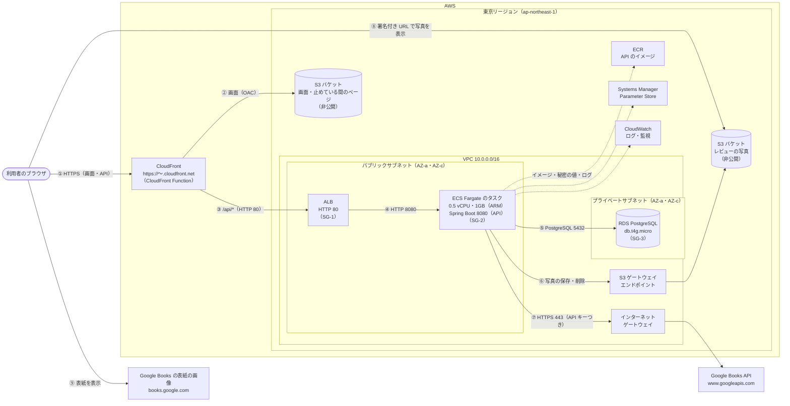
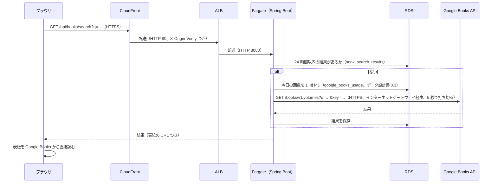

# インフラ設計書：読書記録アプリ（BookLog）

| 項目 | 内容 |
| --- | --- |
| 文書番号 | BL-BD-INFRA |
| 版数 | 0.2 |
| 作成日 | 2026-11-02 |
| 最終更新日 | 2026-11-06 |
| 作成者 | （氏名） |
| 上位文書 | [基本設計書](basic-design.md)（BL-BD） |
| 元にした文書 | [要件定義書](../requirements/requirements.md)（BL-REQ）版数 0.4 の P-2・P-3・P-5・P-6・11 章、[技術スタック定義書](../tech-stack.md)（BL-TECH）版数 0.1 |
| 状態 | 承認待ち |

## 改訂履歴

| 版数 | 日付 | 内容 | 作成者 |
| --- | --- | --- | --- |
| 0.1 | 2026-11-02 | 初版。Raise timeline のインフラ設計書（最後の構成）と同じ形にし、Google Books API への通信と API キーを足した | （氏名） |
| 0.2 | 2026-11-06 | 5.2 から手順の置き場所（基本設計書 2.2.1）へリンクした。9 章の No.3 を決定にした | （氏名） |

本書は基本設計書の一部である。承認は[基本設計書](basic-design.md)で一括して行う。表記のルールは基本設計書 1.3 のとおり。

公開は検収のときだけ環境を作って行い、使わない間は止め、検収が終わったら環境を消す（要件定義書 P-6）。本書は、公開するときの構成を決めておくものである。

---

## 1. 方針

| No | 方針 | 理由 |
| --- | --- | --- |
| 1 | CloudFront（入口）→ ALB（ロードバランサー）→ ECS Fargate（API のコンテナ）→ RDS（データベース）の構成にし、画面と写真は S3 に置く | 要件定義書 P-5。Raise timeline と同じ構成で、作り方と手順をそのまま使う |
| 2 | 画面（React をビルドしたファイル）は S3 に置き、CloudFront から配る。API と同じ CloudFront の URL にし、/api/* だけを ALB に送る | 画面の配信に API のサーバーを使わない。同じ URL なので、JWT を入れる Cookie と CSRF 対策は開発中と同じに動く |
| 3 | API は ECS Fargate で動かす。サーバー（EC2）は自分で持たない | OS の更新やログインの管理が要らない。イメージを替えるだけで反映でき、失敗したら前のものに戻る |
| 4 | Fargate の前に ALB を置く。HTTPS は CloudFront で受け、CloudFront → ALB は HTTP にする | タスクは作り直すたびに IP が変わるので、ALB で受け止めてヘルスチェックに通ったタスクにだけ送る。独自ドメインがないため ALB に証明書を付けられず、HTTPS は CloudFront の https://〜.cloudfront.net で受ける（N-11） |
| 5 | ALB は CloudFront からの通信だけを受け、さらに CloudFront が付ける秘密のヘッダー（X-Origin-Verify）がなければ 403 を返す | セキュリティグループだけでは、ほかの人の CloudFront を通した通信も届いてしまうため |
| 6 | Fargate のタスクはパブリックサブネットに置き、パブリック IP を付けるが、ALB からの通信しか受け付けない（SG-2） | タスクから Google Books API（インターネット）・ECR・Parameter Store・CloudWatch Logs に出る必要がある。プライベートサブネットに置くと NAT ゲートウェイ（月 7,000 円ほど）が要る。費用を抑えつつ、ALB を通らない通信を受けないようにする（技術スタック定義書 3.5） |
| 7 | Google Books API へは、タスクのパブリック IP からインターネットゲートウェイを通って HTTPS（443）で出る。API キーは Parameter Store に置き、タスクの起動時に環境変数で渡す | 要件定義書 P-3・N-18。キーをイメージ・リポジトリ・画面に置かない |
| 8 | RDS はプライベートサブネットに置き、Fargate のタスクからしか接続できないようにする。Multi-AZ にはしない | データベースは外から見えないのが基本。Multi-AZ は費用が 2 倍になり、学習用には要らない |
| 9 | 写真の S3 のバケットは非公開にし、写真は署名付き URL でブラウザに直接渡す | 要件定義書 N-16。写真を API 経由で送らないので、タスクの負荷と通信量を抑えられる |
| 10 | 本の表紙は、ブラウザが Google Books から直接読む | 要件定義書 P-3。表紙を保存・中継しないので、S3 と通信の費用がかからない |
| 11 | 使わない間は、ECS のサービスと ALB を消し、RDS を止める。CloudFront は消さずに、止めている間は「止めています」のページを出す | 要件定義書 P-6。ALB は止められず、置いておくだけで月 約 3,500 円かかる（7 章）。CloudFront を消すと、作り直したときに URL が変わってしまう |

## 2. 構成図

| 番号 | 通信 | 内容 |
| --- | --- | --- |
| ① | ブラウザ → CloudFront | 画面（HTML・JS）と API。HTTP（80）で来たら HTTPS（443）に移す。証明書は CloudFront のもの（*.cloudfront.net）を使う |
| ② | CloudFront → S3（画面） | /api/*・/actuator/* 以外。S3 は CloudFront からだけ読める（OAC）。画面の URL（/books/56 など）は CloudFront Function が index.html に書き換える（5.3） |
| ③ | CloudFront → ALB | /api/*・/actuator/*。HTTPS を解いて、HTTP の 80 で ALB に送る。秘密のヘッダー X-Origin-Verify を付ける |
| ④ | ALB → Fargate | HTTP の 8080。ALB はヘルスチェック（/actuator/health）に通ったタスクにだけ送る |
| ⑤ | Fargate → RDS | PostgreSQL の 5432。VPC の中だけで通る |
| ⑥ | Fargate → S3（写真） | 写真の保存と削除。S3 ゲートウェイエンドポイントを通るので、インターネットに出ない |
| ⑦ | Fargate → Google Books API | 書籍検索と本の取り込み（FN-02）。タスクのパブリック IP から、インターネットゲートウェイを通って HTTPS で出る。5 秒で打ち切る |
| ⑧ | ブラウザ → S3（写真） | API が発行した署名付き URL（15 分）で、ブラウザが S3 から写真を直接読む |
| ⑨ | ブラウザ → Google Books（表紙） | 本の表紙の画像を、保存した URL でブラウザが直接読む |

タスクは、起動するときに ECR からイメージを、Parameter Store から秘密の値を取り、動いている間は CloudWatch Logs にログを送る。どれもパブリック IP を使ってインターネット経由で通る（方針 6）。

## 3. リソース一覧

Terraform（deploy/terraform/）で作る。名前の頭は「bl-」にする。

### 3.1 ネットワーク

| リソース | 名前 | 設定 |
| --- | --- | --- |
| VPC | bl-vpc | 10.0.0.0/16 |
| パブリックサブネット | bl-public-a / bl-public-c | 10.0.0.0/24（AZ-a）、10.0.1.0/24（AZ-c）。ALB は 2 つの AZ が必要。Fargate のタスクもここに置く |
| プライベートサブネット | bl-private-a / bl-private-c | 10.0.10.0/24（AZ-a）、10.0.11.0/24（AZ-c）。RDS のサブネットグループは 2 つの AZ が必要。インターネットには出ない |
| インターネットゲートウェイ | bl-igw | パブリックサブネットのルートに付ける。タスクから Google Books API へ出る通信もここを通る |
| S3 ゲートウェイエンドポイント | bl-s3-endpoint | パブリック・プライベート両方のルートに付ける（無料） |

### 3.2 入口・API・データベース・ストレージ

| リソース | 名前 | 設定 |
| --- | --- | --- |
| CloudFront | booklog | 価格クラスは PriceClass_200（日本を含む）。ビューワーは HTTPS に移す。既定は画面のバケット（OAC、CachingOptimized）。`/api/*`・`/actuator/*` は ALB の HTTP 80 へ、キャッシュしない・すべてのメソッド・Cookie とクエリとヘッダーを渡す。止めている間は ALB へのビヘイビアをなくし、すべてのパスで止めている間のページを返す |
| CloudFront Function | bl-router | 動いている間は画面の URL を index.html に、止めている間はすべてを maintenance/index.html に書き換える（5.3） |
| ALB | bl-alb | インターネット向け、パブリックサブネット a・c、HTTP 80。X-Origin-Verify が合うときだけターゲットグループ bl-app（IP、8080、ヘルスチェック /actuator/health）に送り、ほかは 403。止めている間は消す |
| ECR | bl-app | API のイメージ。タグはコミット ID で上書きさせない（IMMUTABLE）。push したときに脆弱性を検査する。新しいものから 10 個だけ残す |
| ECS クラスター | bl-cluster | Fargate。Container Insights は使わない（費用がかかるため） |
| ECS タスク定義 | bl-app | Fargate、ARM64（Graviton）、0.5 vCPU・メモリ 1GB。環境変数で DB の接続先・Cookie の Secure・バケット名を、Parameter Store から DB のパスワード・JWT の秘密の値・Google Books API の API キーを渡す。ログは CloudWatch Logs の /bl/app へ。止めている間は消す |
| ECS サービス | bl-app | タスクは 1 つ（毎日 4:30 の定期の処理が重ならないように）。パブリック IP あり。起動から 180 秒はヘルスチェックの失敗で止めない。新しいタスクが起動しなければ前のタスク定義に戻す（デプロイのサーキットブレーカー）。止めている間は消す |
| RDS | bl-db | PostgreSQL 17、db.t4g.micro、gp3 20GB、Single-AZ、パブリックアクセスなし、自動バックアップ 1 日（N-9。無料プランの上限。有料プランにしたら 7 日にする）、保存時の暗号化あり、削除保護あり、消すときは最後のスナップショットを取る |
| S3 バケット（画面） | bl-web-{アカウント ID} | パブリックアクセスをすべてブロック、SSE-S3。画面のファイルと、止めている間のページ（maintenance/）を置く。CloudFront だけが読める（OAC） |
| S3 バケット（写真） | bl-photos-{アカウント ID} | パブリックアクセスをすべてブロック、SSE-S3、バージョニングなし。レビューの写真を reviews/ の下に置く |

### 3.3 権限・秘密の値・監視

| リソース | 名前 | 設定 |
| --- | --- | --- |
| IAM ロール（タスクの実行） | bl-task-execution | ECS がタスクを起動するときに使う。AmazonECSTaskExecutionRolePolicy と、Parameter Store の /bl/db/password・/bl/jwt/secret・/bl/google-books/api-key の読み取り |
| IAM ロール（タスク） | bl-app | アプリ（AWS SDK）が使う。S3：bl-photos-{アカウント ID}/reviews/* への PutObject・GetObject・DeleteObject のみ |
| Parameter Store | /bl/db/password、/bl/jwt/secret | データベースのパスワード、JWT の署名に使う秘密の値（48 文字の乱数）。Terraform が作り、SecureString で置く |
| Parameter Store | /bl/google-books/api-key | Google Books API の API キー（公開用）。Google Cloud で作ったキーを、手で AWS CLI から SecureString で置く。Terraform は名前（ARN）だけを使い、値を読まない（Terraform の状態ファイルにキーを残さないため） |
| CloudWatch Logs | /bl/app | Spring Boot のログ（JSON。基本設計書 2.3）。30 日で消す |
| CloudWatch アラーム | bl-no-healthy-task、bl-api-5xx、bl-db-free-storage | ALB のヘルスチェックに通るタスクが 3 分続けてない、API の 5xx が 5 分で 10 回以上（この 2 つは動いている間だけ作る）、RDS の空き容量 2GB 未満で、SNS（bl-alerts）からメールを送る |
| AWS Budgets | bl-budget | 月の費用が予算（R-1。67 ドル ≒ 10,000 円）の 80% を超えたとき、月末の予測が予算を超えそうなときにメールを送る |

Google Books API の呼び出しが上限に近いこと（基本設計書 2.3 の警告のログ）は、CloudWatch Logs Insights で確かめる。アラームにはしない（上限に達しても、書籍検索だけが止まり、ほかは使えるため。N-8）。

Terraform の状態ファイル（DB のパスワードなどの秘密の値も入る）は手元に置き、リポジトリには入れない。

## 4. セキュリティグループ（通信の許可）

| ID | 付ける先 | 受け付ける通信 | 送り元 | 外へ出る通信 | 理由 |
| --- | --- | --- | --- | --- | --- |
| SG-1 | ALB | TCP 80 | CloudFront のみ（AWS が管理するプレフィックスリスト com.amazonaws.global.cloudfront.origin-facing） | SG-2 の 8080 だけ | CloudFront を通らない通信を受けない。さらに秘密のヘッダーで確かめる（方針 5） |
| SG-2 | Fargate のタスク | TCP 8080 | SG-1 のみ | HTTPS の 443（Google Books API・ECR・Parameter Store・CloudWatch Logs・S3。宛先の IP が決まらないので宛先は絞らない）と、SG-3 への 5432 だけ | ALB を通らない通信を受けない（方針 6） |
| SG-3 | RDS | TCP 5432 | SG-2 のみ | なし | Fargate のタスクからしか接続させない |

## 5. 処理の流れ

### 5.1 書籍検索

### 5.2 公開の手順（概要）

1. API：手元で `mvnw package` で jar を作り、`docker buildx build --platform linux/arm64` でイメージを作って、コミット ID をタグにして ECR に push する
2. 初めて作るときだけ、Google Cloud で公開用の API キーを作り（Books API だけに使える制限をかける）、AWS CLI で /bl/google-books/api-key に置く
3. `terraform apply -var running=true` で、そのイメージを使う新しいタスク定義を作る。ECS が新しいタスクを起動し、ALB のヘルスチェックに通ったら古いタスクを止める（Flyway が起動時にテーブルを更新する）
4. 画面：frontend で `npm run build` して、できたファイルを画面のバケットに置き、index.html の CloudFront のキャッシュを消す
5. CloudFront の URL の /actuator/health が正常（200）になったこと、書籍検索ができることを確かめる

詳しい手順は[基本設計書 2.2.1](basic-design.md#221-公開環境の手順)に書いた。

### 5.3 画面の配り方

Raise timeline と同じにする。

| パス | 返すもの | Cache-Control | 理由 |
| --- | --- | --- | --- |
| /assets/… | Vite がビルドした JS・CSS | max-age=31536000, public, immutable（1 年） | ファイル名に中身のハッシュが付き、中身が変われば URL も変わる |
| /books/56 などの画面の URL（最後の部分に拡張子がない） | index.html（CloudFront Function が書き換える） | no-cache | 直接開いたり読み直したりしても、画面（React Router）に任せる |
| /api/… | API（ないものは JSON の 404） | | ALB へ送るので index.html を返さない |
| /actuator/… | 稼働の確認 | | 同上 |
| 拡張子があってファイルがない | 403（S3 が返す） | | 同上 |

CloudFront のエラーページの設定（403・404 のときに index.html を返す）は使わない。API の 403・404 まで index.html になってしまうため。

## 6. 開発環境との対応

開発中は、写真の保存先と Google Books API のほかは AWS を使わず、手元の Docker Compose で同じ役割のものを動かす。ポートは CLAUDE.md の「サーバーのポート」のとおり。

| 役割 | 開発環境 | 自動のテスト | AWS |
| --- | --- | --- | --- |
| 入口 | なし（ブラウザから直接） | なし | CloudFront（443）→ ALB（80） |
| 画面 | Vite の開発サーバー（5173）。API への通信は 8080 に転送する | Vitest（jsdom）。E2E は jar に入れた画面 | S3（bl-web-{アカウント ID}）のファイルを CloudFront が配る |
| API | Spring Boot（8080。mvnw spring-boot:run） | Spring Boot（テストの中、E2E は jar） | ECS Fargate のタスク（8080） |
| データベース | PostgreSQL のコンテナ（5432） | Testcontainers の PostgreSQL | RDS（5432） |
| 写真の保存先 | S3 の開発用のバケット（bl-photos-dev-{アカウント ID}）。鍵は手元の ~/.aws/credentials | Testcontainers の MinIO（chainguard/minio） | S3（bl-photos-{アカウント ID}）。鍵はタスクロール |
| Google Books API | 本物。開発用の API キー（公開用とは分ける） | API のテストは MockRestServiceServer、E2E は Node.js の偽物のサーバー（技術スタック定義書 3.6）。本物は呼ばない | 本物。公開用の API キー |
| 秘密の値 | .env ファイル（リポジトリには入れない） | テストの中で決めた値 | Parameter Store |

アプリは接続先（データベースの URL、S3 のバケット名、テストのときだけ S3 のエンドポイント、Google Books API の URL と API キー）を環境変数で受け取り、開発環境と AWS でコードを変えない（N-27）。E2E の偽物のサーバーのポートは、E2E を作るときに決め、CLAUDE.md の「サーバーのポート」の表に足す。

開発中の書籍検索も、1 日の上限（1,000 回）に数える。開発用と公開用でキーを分けるので、Google Books の側の上限はキーのプロジェクトごとに数えられる。開発用のデータベースの google_books_usage は、公開先とは別に数える。

## 7. 費用の目安

東京リージョンで、1 か月（730 時間）動かし続けた場合の概算である。1 ドル 150 円で計算した。料金は変わることがあるため、構築の前に AWS Pricing Calculator で確かめ、結果を技術スタック定義書 6 章に記録する。

| サービス | 内容 | 月額（概算） |
| --- | --- | --- |
| CloudFront | 少ない通信量（ずっと無料の枠：毎月 1TB・1,000 万リクエストまで）、CloudFront Function | 0 円 |
| ALB | 時間あたりの料金 ＋ 少ない LCU | 約 3,500 円 |
| ECS Fargate | ARM・0.5 vCPU・1GB を 1 つ | 約 2,200 円 |
| パブリック IPv4 | ALB の 2 つ ＋ タスクの 1 つ（1 つ 1 時間 0.005 ドル） | 約 1,600 円 |
| RDS | db.t4g.micro ＋ gp3 20GB ＋ バックアップ | 約 3,200 円 |
| S3・ECR | 写真 14GB（データ設計書 10 章）＋ 読み出し、画面のファイル、イメージ 10 個 | 約 400 円 |
| CloudWatch・Parameter Store | 少ない量 | 約 100 円 |
| データの転送（外への通信） | Google Books API への問い合わせ（1 日 1,000 回まで、小さな通信） | ほぼ 0 円 |
| Google Books API | 無料（1 日の上限の中） | 0 円 |
| 合計 | | 約 11,000 円 |

動かし続けると、R-1 の予算（月 10,000 円）を超える。そのため、公開は検収の期間だけにし、その間も使わない時間は止める（方針 11）。たとえば検収の 7 日間に 1 日 8 時間だけ動かすと、ALB・Fargate・パブリック IP・RDS の時間の分が 約 750 円になる。

止めている間の費用：ECS のサービスと ALB は消すので、かからない。RDS はストレージの分（約 500 円／月）だけかかる。S3・ECR は置いている量の分（約 300 円／月）かかる。RDS は止めても 7 日たつと自動で起動するため、長く止めるときは、スナップショットを取ってから消す。検収が終わったら、すべて消す（P-6）。

公開に使う AWS アカウントが無料プランのときは、費用はクレジットから引かれる。無料プランの上限のため、RDS の自動バックアップは 1 日分にする（3.2）。

## 8. 構築の方法

AWS のリソースは、手作業ではなく Terraform で作る。Raise timeline の deploy/terraform と同じ書き方・同じバージョンにする（Terraform 1.16.5、AWS プロバイダー 6.68.0、TFLint。[技術スタック定義書](../tech-stack.md) 3.5）。

| 項目 | 内容 |
| --- | --- |
| 置き場所 | deploy/terraform/（止めている間のページは deploy/maintenance/） |
| 起動・停止 | 変数 running で切り替える。running = false にすると、CloudFront をすべて止めている間のページにしてから、ECS のサービス・タスク定義・ALB・ALB のアラームを消す。running = true にすると作り直す。RDS の停止・起動はスクリプトで AWS CLI から行う |
| 手で作るもの | Google Books API の API キー（Google Cloud）と、それを入れる Parameter Store の /bl/google-books/api-key（3.3） |
| CI | GitHub Actions で terraform fmt -check・terraform validate・tflint を動かし、jar からイメージが作れることを確かめる。plan・apply は手元で行う |

## 9. 未決事項

| No | 内容 | 関係する要件 |
| --- | --- | --- |
| 1 | （決定）独自ドメインは取らず、CloudFront の URL で公開する（Raise timeline と同じ） | P-5、N-11 |
| 2 | （決定）Google Books API へは、NAT ゲートウェイを置かず、パブリックサブネットのタスクから直接出る（方針 6・7）。2026-11-02 に決めた | P-3、技術スタック定義書 3.5 |
| 3 | （決定）公開用の Google Books API の 1 日の実際の上限は 1,000 回。2026-11-06 に Google Cloud のコンソールで確かめた（要件定義書 U-2） | U-2、R-6 |
