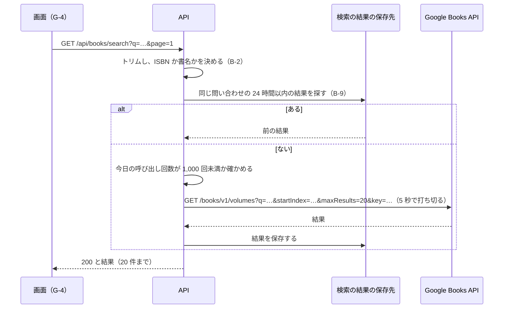
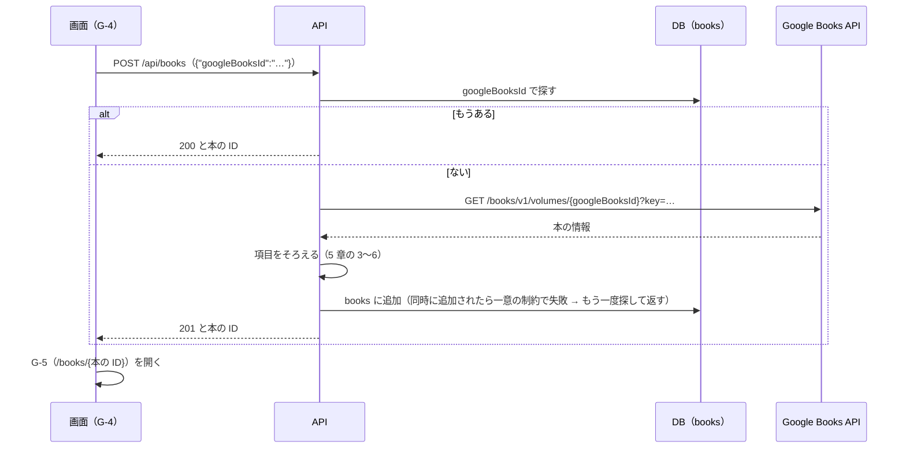

# 機能定義書 FN-02 書籍検索・登録：読書記録アプリ（BookLog）

| 項目 | 内容 |
| --- | --- |
| 文書番号 | BL-FD-02 |
| 版数 | 0.2 |
| 作成日 | 2026-11-01 |
| 最終更新日 | 2026-11-02 |
| 作成者 | （氏名） |
| 上位文書 | [機能定義書](function-definition.md)（BL-FD） |
| 状態 | 承認待ち |

## 改訂履歴

| 版数 | 日付 | 内容 | 作成者 |
| --- | --- | --- | --- |
| 0.1 | 2026-11-01 | 初版 | （氏名） |
| 0.2 | 2026-11-02 | 検索の結果の保存先と呼び出し回数の数え方がデータ設計書で決まったので、3.1 と 7 章に表の名前と参照先を書いた | （氏名） |

本書は機能定義書の一部である。承認は[機能定義書](function-definition.md)で一括して行う。API とメッセージの共通の決まりは機能定義書 3 章・4 章のとおり。

---

## 1. 概要

| 項目 | 内容 |
| --- | --- |
| 目的 | ISBN か書名で本を探し、選んだ本の情報（書名・著者・表紙など）を手で入れずにアプリに取り込めるようにする |
| 使う画面 | 全画面のヘッダーの書籍の検索欄、G-4 書籍検索の結果画面 |
| 関係する機能 | FN-10 本のページ（選んだ本を開く）、FN-03 レビュー・FN-08 読書ステータス（取り込んだ本に付ける） |
| 前提 | 本の情報は Google Books API から取る。API キーはサーバーだけが持つ（要件定義書 P-3、N-18）。1 日に呼べる回数は 1,000 回とみなす（U-2）。見つからない本の手入力は作らない（U-3） |

## 2. 機能要件

| ID | 内容 |
| --- | --- |
| B-1 | ヘッダーの検索欄に ISBN か書名（著者名も可）を入れて Enter キーを押すか、虫めがねのボタンを押すと、書籍検索の結果画面（G-4）を開いて結果を出す。トリムした後で 0 文字のときは M-12 を出し、検索しない |
| B-2 | 入れた文字から「-」と空白を取り除いて 10 桁（最後は X でもよい）か 13 桁の数字になるときは ISBN として探し、そのほかは書名・著者名として探す |
| B-3 | 結果は 20 件ずつ出す。1 件ごとに表紙・書名・著者・出版社・出版日を出す。一番下の「もっと見る」を押すと次の 20 件を足す。結果は最大 100 件までとし、それより後は出さない |
| B-4 | 結果が 0 件のときは M-13 を出す |
| B-5 | 結果の本を押すと、その本をアプリに取り込み（まだなければ）、本のページ（G-5）を開く |
| B-6 | 同じ本（Google Books の ID が同じ）は 1 つにまとめる。ほかの人がすでに取り込んだ本を選んだときは、同じ本のページを開く |
| B-7 | 表紙がない本は、表紙の代わりに「表紙なし」の枠を出す（要件定義書 R-7） |
| B-8 | Google Books API が使えないとき（止まっている、応答が 5 秒を超える、1 日の回数の上限に達した）は M-14 を出す。すでに取り込んだ本のページ・レビュー・本棚はそのまま使える（N-8） |
| B-9 | 同じ文字で同じページを 24 時間以内に探したときは、Google Books API を呼ばずに前の結果を出す（要件定義書 R-6） |
| B-10 | G-4 の URL（/books/search?q=…）を直接開いたときや、ブラウザの「戻る」で戻ったときも、同じ文字で検索した結果を出す。検索欄にはその文字を入れておく |

## 3. 処理の流れ

### 3.1 検索

検索の結果の保存先と呼び出し回数は、どちらも PostgreSQL の表（book_search_results・google_books_usage）に置く。使い回し方と数え方は[データ設計書](../design/data-design.md) BR-12・BR-13 のとおり。

### 3.2 本を選んで取り込む

## 4. 入力の確認

| 項目 | 型 | 必須 | 条件 | 守られないとき |
| --- | --- | --- | --- | --- |
| 検索の文字（q） | 文字列 | ○ | トリム後 1〜100 文字。101 文字目以降は入力できない | 0 文字なら M-12（API は 400 QUERY_REQUIRED） |
| ページ（page） | 数値 | | 1〜5。省いたら 1 | 400 BAD_REQUEST |
| Google Books の ID | 文字列 | ○ | 1〜40 文字の英数字と「-」「_」 | 400 BAD_REQUEST |

ISBN の 10 桁のときは、最後の 1 桁（チェックディジット）が合っているかは確かめない（Google Books API に任せる）。

## 5. 業務ルール

| No | ルール |
| --- | --- |
| 1 | ISBN として探すときは、Google Books API に `q=isbn:{数字}` を送る。書名・著者名として探すときは、入れた文字をそのまま q に送り、printType=books を付ける |
| 2 | 結果の 20 件は Google Books API が返した順に出す。Google Books API が返す件数の合計（totalItems）は正確でないことがあるため、次のページがあるかは「20 件そろって返ってきたか」で決める |
| 3 | 書名は title に subtitle があれば「title subtitle」（間に全角の空白）にして持つ |
| 4 | ISBN は industryIdentifiers の ISBN_13 を使う。ISBN_10 しかないときは 13 桁に直す。どちらもないときは持たない |
| 5 | 表紙の URL は imageLinks の thumbnail を使い、http を https に直す。ないときは持たない |
| 6 | 紹介文（description）は HTML のタグを取り除いて文字だけを持つ |
| 7 | 取り込んだ本の情報は、その後 Google Books の側で変わっても直さない（要件定義書 P-4） |
| 8 | 呼び出し回数は日本時間の 0 時に 0 に戻す。1,000 回に達したら、その日は Google Books API を呼ばずに 503 を返す。前の結果を使う検索（B-9）と、もう取り込んだ本の選択は、上限に達した後も使える |
| 9 | 自動のテストでは Google Books API を呼ばず、決まった結果を返す偽物に替える（要件定義書 N-28） |

## 6. API（案）

| メソッド | URL | 入力 | 出力（成功） | 主なエラー |
| --- | --- | --- | --- | --- |
| GET | /api/books/search?q=&page= | 検索の文字、ページ | 200 `{"items":[検索の結果…],"hasNext":true}` | 400 QUERY_REQUIRED、503 BOOK_SEARCH_UNAVAILABLE |
| POST | /api/books | `{"googleBooksId"}` | 201（新しく取り込んだ）または 200（もうあった） `{"id":56}` | 400、404 GOOGLE_BOOK_NOT_FOUND、503 BOOK_SEARCH_UNAVAILABLE |

検索の結果：`{"googleBooksId":"zyTCAlFPjgYC","title":"…","authors":["…"],"publisher":"…","publishedDate":"2024-05","isbn13":"9784…","thumbnailUrl":"https://…"}`。まだ取り込んでいない本もあるため、アプリの本の ID は持たない。

## 7. 使うデータ

| 対象 | 操作 | 内容 |
| --- | --- | --- |
| books | C R | 本の取り込み、取り込み済みかの確認 |
| book_search_results | C R U D | 24 時間分の検索の結果 |
| google_books_usage | C R U D | 日ごとの Google Books API の呼び出し回数 |
| Google Books API | R | 検索、1 冊の情報 |

## 8. 権限

| 操作 | ログインしている人 |
| --- | --- |
| 本を探す | できる |
| 本を取り込む | できる |
| 取り込んだ本の情報を直す・消す | できない（誰も） |

## 9. エラーとメッセージ

| 場面 | HTTP | code | メッセージ |
| --- | --- | --- | --- |
| 検索の文字が空 | 400 | QUERY_REQUIRED | M-12 |
| 結果が 0 件 | 200 | — | M-13 |
| Google Books API が止まっている・5 秒を超えた・上限に達した | 503 | BOOK_SEARCH_UNAVAILABLE | M-14 |
| 選んだ本が Google Books に見つからない（消された） | 404 | GOOGLE_BOOK_NOT_FOUND | M-15 |
| 本の取り込みに失敗（データベースの障害） | 500 | INTERNAL_ERROR | M-30 |

## 10. テストの観点

- TC-02-1：「978-4-10-101001-6」「4101010013」「9784101010014」は ISBN として、「吾輩は猫」「夏目漱石」は書名・著者名として探す（Google Books API に送る q を確かめる）
- TC-02-2：空白だけを入れて検索すると M-12 で、API は呼ばない
- TC-02-3：20 件 → 「もっと見る」で 40 件。100 件より後は「もっと見る」を出さない
- TC-02-4：同じ文字・同じページで 2 回探すと、2 回目は Google Books API を呼ばない。24 時間を過ぎると呼ぶ
- TC-02-5：呼び出し回数が 1,000 回に達した後は M-14 が出て、前の結果のある検索は出せる。日本時間の 0 時を過ぎると探せる
- TC-02-6：Google Books API が 500・429 を返したとき、6 秒かかったときに M-14 が出て、本のページ・本棚は使える
- TC-02-7：同じ本を 2 人が同時に選んでも、books の行は 1 つ
- TC-02-8：表紙のない本・ISBN のない本・ISBN_10 だけの本・subtitle のある本・紹介文に HTML のタグがある本を取り込んだときの項目（5 章の 3〜6）
- TC-02-9：本の情報に `<script>` を含む本（偽物で用意）が、文字のまま出る（N-17）
- TC-02-10：画面の通信を見ても、Google Books API の API キーが出てこない（N-18）
- TC-02-11：/books/search?q=… を直接開くと、検索欄に文字が入り、結果が出る
