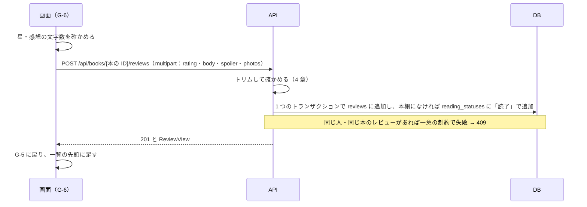
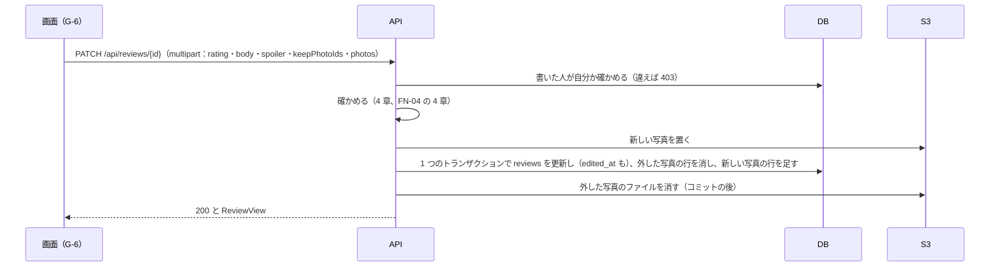
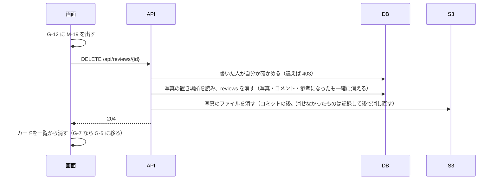

# 機能定義書 FN-03 レビュー：読書記録アプリ（BookLog）

| 項目 | 内容 |
| --- | --- |
| 文書番号 | BL-FD-03 |
| 版数 | 0.1 |
| 作成日 | 2026-11-01 |
| 最終更新日 | 2026-11-01 |
| 作成者 | （氏名） |
| 上位文書 | [機能定義書](function-definition.md)（BL-FD） |
| 状態 | 承認待ち |

## 改訂履歴

| 版数 | 日付 | 内容 | 作成者 |
| --- | --- | --- | --- |
| 0.1 | 2026-11-01 | 初版 | （氏名） |

本書は機能定義書の一部である。承認は[機能定義書](function-definition.md)で一括して行う。API とメッセージの共通の決まりは機能定義書 3 章・4 章のとおり。

---

## 1. 概要

| 項目 | 内容 |
| --- | --- |
| 目的 | 読んだ本に星（1〜5）と感想でレビューを書き、編集・削除し、1 つのレビューを詳しく見られるようにする。ネタバレのあるレビューは伏せて出す |
| 使う画面 | G-6 レビューの投稿・編集画面、G-7 レビューの詳細画面、レビューのカード（G-3・G-5・G-8）、G-12 確認ダイアログ |
| 関係する機能 | FN-04 写真（レビューと一緒に保存する）、FN-05 参考になった・FN-06 コメント（レビューの削除で一緒に消える）、FN-08 読書ステータス（レビューを書くと「読了」で本棚に入る）、FN-09 タイムライン・FN-10 本のページ・FN-11 プロフィール（レビューのカードを並べる） |
| 前提 | 1 人が 1 冊に書けるレビューは 1 つ（データ要件定義書 3 章）。編集の履歴（前の感想）は残さない |

## 2. 機能要件

| ID | 内容 |
| --- | --- |
| RV-1 | 本のページ（G-5）の「レビューを書く」を押すと、G-6 を開く。その本のレビューをもう書いているときは、ボタンが「レビューを編集」になり、G-6 に今のレビューを入れて開く |
| RV-2 | G-6 で星を選び、感想を入れ、必要なら「ネタバレあり」に印を付けて「投稿する」を押すと、レビューを投稿して G-5 に戻る。投稿したレビューは G-5 の一覧の先頭に出る |
| RV-3 | 星は 1〜5 から 1 つ選ぶ（必須）。選んでいないときは M-16 を出す |
| RV-4 | 感想はトリムした後で 1〜2,000 文字とする。入力欄の下に残りの文字数を出し、2,000 文字を超えたら残りの文字数を赤字の負の数で出して「投稿する」を押せないようにする。0 文字のときは M-17 を出す |
| RV-5 | レビューを投稿したとき、その本が自分の本棚になければ「読了」で入れる。すでに本棚にあるときは、ステータスを変えない（FN-08） |
| RV-6 | レビューは「レビューのカード」で出す。書いた人の表示名・@ユーザー ID・投稿日時、本の表紙・書名・著者、星、感想、写真、参考になったの数、コメント数を出す。一覧では感想を 5 行まで出し、続きは「続きを読む」で G-7 を開いて読む |
| RV-7 | 感想の改行はそのまま出す。URL はリンクにしない。HTML の記号はそのまま文字として出す（N-17） |
| RV-8 | レビューのカードの感想またはコメント数を押すと、レビューの詳細画面（G-7）を開く。本の表紙・書名を押すと G-5 を開く |
| RV-9 | 自分のレビューのカードにだけ「…」メニュー（「編集」「削除」）を出す。「編集」を押すと G-6 を開く。「削除」を押すと G-12 に M-19 を出し、「削除」でそのレビューと写真・コメント・参考になったを削除する。「キャンセル」では何もしない。本棚の読書ステータスは変えない |
| RV-10 | G-6 の編集では、星・感想・ネタバレあり・写真を変えられる。「保存する」で変え、G-5 に戻る。「キャンセル」では変えずに戻る。何も変えていないときは「保存する」を押せない。一度でも編集したレビューは、投稿日時の後ろに「（編集済み）」と出す。編集しても投稿日時と並び順は変わらず、参考になった・コメントもそのまま残す |
| RV-11 | 「ネタバレあり」のレビューは、すべての画面（G-3・G-5・G-7・G-8）で、感想と写真の代わりに「ネタバレあり」の枠と「ネタバレを表示」ボタンを出す。G-7 ではコメントの一覧とフォームも伏せる。星・書名・書いた人は伏せない |
| RV-12 | 「ネタバレを表示」を押すと、そのレビューの感想と写真（G-7 ではコメントも）を出す。開いた状態は、その画面を開いている間だけ覚え、画面を移ったり読み込み直したりすると伏せた状態に戻る。自分のレビューも同じように伏せる |
| RV-13 | 削除されたレビューの詳細画面を開いたときは、レビューの代わりに M-20 を出す |

## 3. 処理の流れ

### 3.1 投稿

写真があるときの流れは FN-04 の 3 章のとおり。写真がないときは S3 を使わない。

送信中は「投稿する」を「投稿中…」にして押せなくする（2 回押して 2 つ投稿されないようにする）。

### 3.2 編集

### 3.3 削除

## 4. 入力の確認

| 項目 | 型 | 必須 | 条件 | 守られないとき |
| --- | --- | --- | --- | --- |
| 星（rating） | 数値 | ○ | 1〜5 の整数 | M-16（API は 400 RATING_REQUIRED） |
| 感想（body） | 文字列 | ○ | トリム後、改行を LF にそろえて 1〜2,000 文字 | 0 文字は M-17（API は 400 BODY_REQUIRED）。2,001 文字以上は画面で送れない（API は 400 BAD_REQUEST） |
| ネタバレあり（spoiler） | 真偽 | ○ | true か false。省いたら false | 400 BAD_REQUEST |
| 写真 | ファイル | | FN-04 の 4 章 | FN-04 の 9 章 |

## 5. 業務ルール

| No | ルール |
| --- | --- |
| 1 | レビューは reviews の一意の制約（user_id, book_id）で 1 人 1 冊 1 つに保つ |
| 2 | レビューの投稿と本棚への追加（RV-5）は 1 つのトランザクションで行う。本棚への追加は、すでにあれば何もしない（INSERT … ON CONFLICT DO NOTHING） |
| 3 | 編集したときは edited_at を記録する。created_at は変えない |
| 4 | レビューを削除したら、その写真・コメント・参考になったも消える（ON DELETE CASCADE）。本と読書ステータスは消さない |
| 5 | ネタバレの伏せ方は画面だけで行う。API は spoiler が true でも感想と写真を返す（機能定義書 3.5） |
| 6 | 感想の数え方は機能定義書 3.1 のとおり（改行を LF にそろえてから、コードポイントで数える） |

## 6. API（案）

| メソッド | URL | 入力 | 出力（成功） | 主なエラー |
| --- | --- | --- | --- | --- |
| POST | /api/books/{本の ID}/reviews | multipart：rating・body・spoiler・photos（0〜4 個） | 201 ReviewView | 400、404 BOOK_NOT_FOUND、409 REVIEW_EXISTS、413、500 |
| GET | /api/reviews/{id} | なし | 200 ReviewView | 404 REVIEW_NOT_FOUND |
| PATCH | /api/reviews/{id} | multipart：rating・body・spoiler・keepPhotoIds（残す写真の ID）・photos（足す写真） | 200 ReviewView | 400、403、404、413、500 |
| DELETE | /api/reviews/{id} | なし | 204 | 403、404 |

ReviewView の形は機能定義書 3.5 のとおり。G-6 を開くときは、GET /api/books/{本の ID}（FN-10）の myReviewId を見て、あれば GET /api/reviews/{id} で今のレビューを読む。

## 7. 使うデータ

| テーブル | 操作 | 内容 |
| --- | --- | --- |
| reviews | C R U D | レビューの投稿・表示・編集・削除 |
| reading_statuses | C | 本棚になければ「読了」で追加（RV-5） |
| books | R | 本があるか、カードの本の情報 |
| review_photos・helpfuls・comments | R D | カードの写真・件数、削除で一緒に消える |
| users | R | 書いた人 |

## 8. 権限

| 操作 | 書いた人 | ほかの人 |
| --- | --- | --- |
| レビューを書く | できる（1 冊に 1 つ） | — |
| レビューを見る | できる | できる |
| 編集・削除 | できる | できない（API は 403） |

## 9. エラーとメッセージ

| 場面 | HTTP | code | メッセージ |
| --- | --- | --- | --- |
| 星を選んでいない | 400 | RATING_REQUIRED | M-16 |
| 感想が空 | 400 | BODY_REQUIRED | M-17 |
| 画面を通さずに送られた、条件に合わない入力（星が 0・6、感想が 2,001 文字など） | 400 | BAD_REQUEST | 入力が正しくありません。 |
| 同じ本のレビューがすでにある（別のブラウザで先に書いたなど） | 409 | REVIEW_EXISTS | M-18。G-6 を編集の状態で開き直す |
| 本がない | 404 | BOOK_NOT_FOUND | M-15 |
| レビューが削除されていた | 404 | REVIEW_NOT_FOUND | M-20。一覧ではカードを消す |
| 他人のレビューを編集・削除しようとした | 403 | FORBIDDEN | M-30 |
| 投稿・保存に失敗 | 500 | INTERNAL_ERROR | M-21。入力した中身は残す |
| 削除に失敗 | 500 | INTERNAL_ERROR | M-30 |

## 10. テストの観点

- TC-03-1：星を選ばずに投稿すると M-16。画面の確認を外して rating=0・6・3.5 を API に送ると 400
- TC-03-2：感想：0 文字（空白・改行だけ）・1 文字・2,000 文字・2,001 文字。改行を CRLF で送っても LF にそろえてから数える
- TC-03-3：同じ本に 2 つ目のレビューを API で送ると 409。G-5 のボタンが「レビューを編集」に変わる
- TC-03-4：本棚にない本のレビューを書くと「読了」で本棚に入る。「読書中」の本に書いてもステータスは「読書中」のまま
- TC-03-5：編集すると「（編集済み）」が付き、タイムラインの位置・参考になった・コメントは変わらない。何も変えないと「保存する」を押せない
- TC-03-6：他人のレビューの PATCH・DELETE を API に直接送ると 403
- TC-03-7：削除すると写真（S3 も）・コメント・参考になったが消え、本と本棚は残る
- TC-03-8：ネタバレありのレビューは G-3・G-5・G-7・G-8 で感想・写真が伏せられ、G-7 ではコメントも伏せられる。星は見える。「ネタバレを表示」で開き、画面を読み込み直すと伏せた状態に戻る
- TC-03-9：ネタバレの印を編集で外す・付けると、表示が変わる
- TC-03-10：感想に `` を入れても文字のまま出る
- TC-03-11：一覧で 6 行以上の感想は 5 行で切れて「続きを読む」が出る
- TC-03-12：削除されたレビューの /reviews/{id} を開くと M-20
