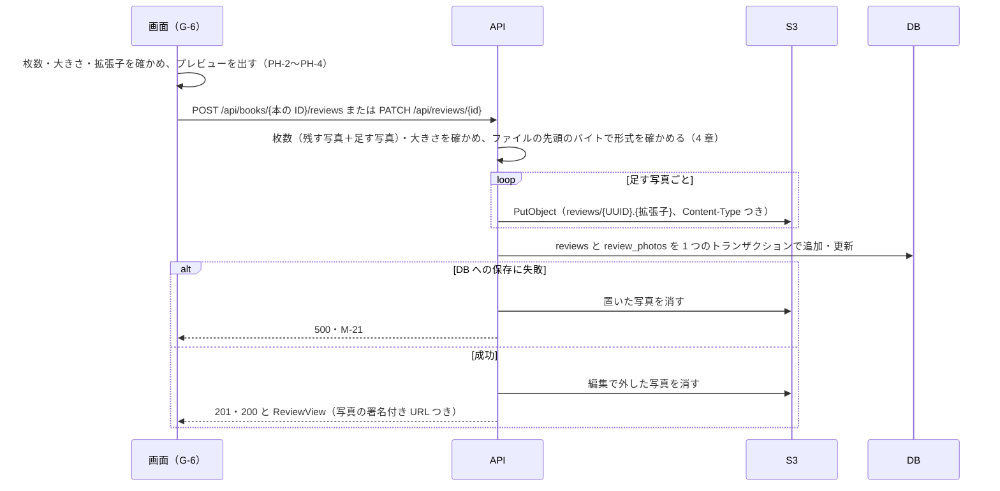
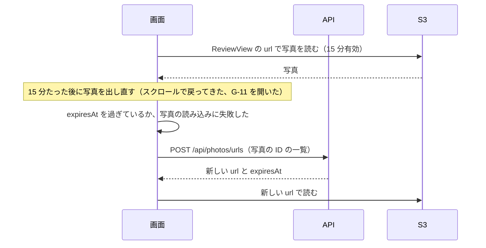

# 機能定義書 FN-04 写真：読書記録アプリ（BookLog）

| 項目 | 内容 |
| --- | --- |
| 文書番号 | BL-FD-04 |
| 版数 | 0.2 |
| 作成日 | 2026-11-01 |
| 最終更新日 | 2026-11-02 |
| 作成者 | （氏名） |
| 上位文書 | [機能定義書](function-definition.md)（BL-FD） |
| 状態 | 承認待ち |

## 改訂履歴

| 版数 | 日付 | 内容 | 作成者 |
| --- | --- | --- | --- |
| 0.1 | 2026-11-01 | 初版 | （氏名） |
| 0.2 | 2026-11-02 | 消せなかった写真の記録と IAM ロールがデータ設計書・インフラ設計書で決まったので、5 章の 6 と 8 章に参照先を書いた | （氏名） |

本書は機能定義書の一部である。承認は[機能定義書](function-definition.md)で一括して行う。API とメッセージの共通の決まりは機能定義書 3 章・4 章のとおり。

---

## 1. 概要

| 項目 | 内容 |
| --- | --- |
| 目的 | レビューに写真を 4 枚まで添え、S3 に保存して、誰でも見られるようにする |
| 使う画面 | G-6 の写真の選択・プレビュー、レビューのカード（G-3・G-5・G-7・G-8）、G-11 写真の拡大ダイアログ |
| 関係する機能 | FN-03 レビュー（写真はレビューと一緒に保存・編集・削除する）、FN-01 退会（その人の写真を消す） |
| 前提 | 写真は AWS S3（開発中は開発用のバケット、自動のテストでは MinIO）に置き、データベースには置き場所だけを持つ（要件定義書 P-2）。S3 は外から読めず、署名付き URL で見せる（N-16）。本の表紙は Google Books の画像を使い、本書の対象ではない |

## 2. 機能要件

| ID | 内容 |
| --- | --- |
| PH-1 | G-6 の「写真を選ぶ」を押すと、ファイルを選ぶ画面を開く。選べるのは JPEG・PNG・WebP で、一度に複数選べる |
| PH-2 | 写真は 1 つのレビューに 4 枚までとする。合わせて 5 枚以上を選んだときは、先に選んだものから 4 枚までを添え、M-22 を出す |
| PH-3 | 1 枚 5MB を超える写真、または PH-1 以外の形式の写真は添えず、M-23 を出す。形式は拡張子だけでなく、ファイルの中身でも確かめる |
| PH-4 | 選んだ写真は G-6 の中に小さく並べて出し、それぞれの「×」で外せる。編集のときは、今の写真も同じように並べ、「×」で外せる |
| PH-5 | 「投稿する」「保存する」を押すと、写真を S3 に保存してからレビューを保存する。保存に失敗したときはレビューも保存せず、M-21 を出す。入力した中身と写真はそのまま残す |
| PH-6 | レビューのカードには、写真を選んだ順にタイル状に並べて出す（1 枚は大きく 1 枚、2〜4 枚は 2 列） |
| PH-7 | 写真を押すと、写真の拡大ダイアログ（G-11）で大きく出す。複数あるときは左右の矢印で切り替える。Esc キー・「×」・写真の外側のクリックで閉じる |
| PH-8 | 写真の URL は 15 分で使えなくなる（N-16）。画面を開いたまま期限が切れて写真を出せなくなったときは、自動で新しい URL を取り直して出す。取り直しても出せないときは、写真の場所に「写真を読み込めませんでした」と出す |

## 3. 処理の流れ

### 3.1 写真つきの投稿・編集

S3 への保存の途中で失敗したときは、それまでに置いた写真を消して 500・M-21 を返す。

### 3.2 表示と URL の取り直し

- 取り直しはレビューごとにまとめて行う。同じレビューの写真がいくつ同時に読み込めなくても、POST /api/photos/urls は 1 回だけ送る
- 取り直した url がまだ期限内なのに読み込めないときは、もう取り直さずに「写真を読み込めませんでした」と出す

## 4. 入力の確認

| 項目 | 条件 | 画面で確かめる | API で確かめる | 守られないとき |
| --- | --- | --- | --- | --- |
| 枚数 | 1 レビュー 0〜4 枚（編集では、残す写真と足す写真の合計） | ○ | ○ | M-22（API は 400 TOO_MANY_PHOTOS） |
| 大きさ | 1 枚 5,242,880 バイト以下 | ○ | ○ | M-23（API は 413 PHOTO_TOO_LARGE） |
| 形式 | JPEG・PNG・WebP | 拡張子と File.type | ファイルの先頭のバイト（マジックナンバー） | M-23（API は 400 PHOTO_TYPE_INVALID） |
| 残す写真の ID | そのレビューの写真の ID だけ | — | ○ | 400 BAD_REQUEST |

| 形式 | ファイルの先頭のバイト |
| --- | --- |
| JPEG | FF D8 FF |
| PNG | 89 50 4E 47 0D 0A 1A 0A |
| WebP | 52 49 46 46（"RIFF"）＋ 8〜11 バイト目が 57 45 42 50（"WEBP"） |

Spring Boot の 1 回の送信の上限は 21MB（写真 4 枚 × 5MB ＋ 感想）にする。超えたら 413。

## 5. 業務ルール

| No | ルール |
| --- | --- |
| 1 | S3 のキーは「reviews/{UUID}.{形式から決めた拡張子}」とする。元のファイル名は使わず、保存もしない |
| 2 | S3 には Content-Type（image/jpeg など）を付けて置く |
| 3 | 写真の大きさの縮小・変換はしない。写真の位置情報（Exif）は消さないため、操作マニュアルで注意する |
| 4 | 署名付き URL の有効期限は 15 分。URL を作るのに S3 との通信はいらないため、一覧を出すたびに作ってよい |
| 5 | 並び順は 0〜3。編集では、残した写真を前の順のまま前に、足した写真を選んだ順に後ろに並べる |
| 6 | S3 の写真を消すのは、レビューを削除したとき、編集で外したとき、書いた人が退会したときだけ（N-10）。どれもデータベースのコミットの後に消し、消せなかったものは記録して 1 日 1 回消し直す（storage_deletions。[データ設計書](../design/data-design.md) BR-5） |

## 6. API（案）

| メソッド | URL | 入力 | 出力（成功） | 主なエラー |
| --- | --- | --- | --- | --- |
| POST | /api/books/{本の ID}/reviews | FN-03 のとおり。photos にファイルを 0〜4 個 | 201 ReviewView | 400 TOO_MANY_PHOTOS・PHOTO_TYPE_INVALID、413 PHOTO_TOO_LARGE、500 |
| PATCH | /api/reviews/{id} | FN-03 のとおり。keepPhotoIds と photos | 200 ReviewView | 同上 |
| POST | /api/photos/urls | `{"photoIds":[77,78]}`（50 個まで） | 200 `{"items":[{"id":77,"url":"…","expiresAt":"…"}]}` | 400 BAD_REQUEST |

POST /api/photos/urls は、削除された写真の ID を受け取ったときは、その ID を結果に含めない（エラーにしない）。

## 7. 使うデータ

| 対象 | 操作 | 内容 |
| --- | --- | --- |
| review_photos | C R D | 写真の置き場所・形式・大きさ・並び順 |
| S3 | C R D | 写真のファイル。R は署名付き URL の発行 |

## 8. 権限

| 操作 | 書いた人 | ほかの人 |
| --- | --- | --- |
| 写真を添える・外す | できる（自分のレビューだけ） | できない |
| 写真を見る | できる | できる |

API のタスクの IAM ロールは、S3 の reviews/ の下だけを読み書きできる（[インフラ設計書](../design/infra-design.md) 3.3）。

## 9. エラーとメッセージ

| 場面 | HTTP | code | メッセージ |
| --- | --- | --- | --- |
| 5 枚以上 | 400 | TOO_MANY_PHOTOS | M-22 |
| 5MB を超える | 413 | PHOTO_TOO_LARGE | M-23 |
| 形式が違う（拡張子を変えたファイル、GIF を含む） | 400 | PHOTO_TYPE_INVALID | M-23 |
| S3 への保存に失敗 | 500 | PHOTO_UPLOAD_FAILED | M-21。入力した中身は残す |
| URL の取り直しに失敗 | 500 | INTERNAL_ERROR | 写真の場所に「写真を読み込めませんでした」と出す |

## 10. テストの観点

- TC-04-1：4 枚は添えられ、5 枚目で M-22。一度に 6 枚選ぶと先の 4 枚だけが残る。写真が 3 枚のレビューの編集で 2 枚足そうとすると M-22
- TC-04-2：5MB ちょうどは添えられ、5MB＋1 バイトは M-23
- TC-04-3：拡張子を .jpg に変えたテキストファイル・PDF・GIF を、画面の確認を外して API に直接送っても 400 になる
- TC-04-4：S3 に写真を置けない状態で投稿すると M-21 で、レビューも写真の行もできておらず、途中まで置いた写真も残っていない
- TC-04-5：編集で 1 枚外して 1 枚足すと、外した写真が S3 から消え、並び順が 5 章の 5 のとおりになる
- TC-04-6：レビューを削除すると S3 の写真も消える。S3 から消せなかったときは記録し、1 日 1 回消し直す
- TC-04-7：S3 のバケットの URL を直接開いても写真が見られない（403）
- TC-04-8：画面を 16 分開いたままにしてから G-11 を開くと、写真が出る（URL を取り直す）。4 枚が同時に読み込めなくても、取り直しは 1 回だけ
- TC-04-9：ほかの人のレビューの写真の ID を keepPhotoIds に入れて送ると 400
- TC-04-10：1〜4 枚それぞれで、カードの並べ方が PH-6 のとおりになる
