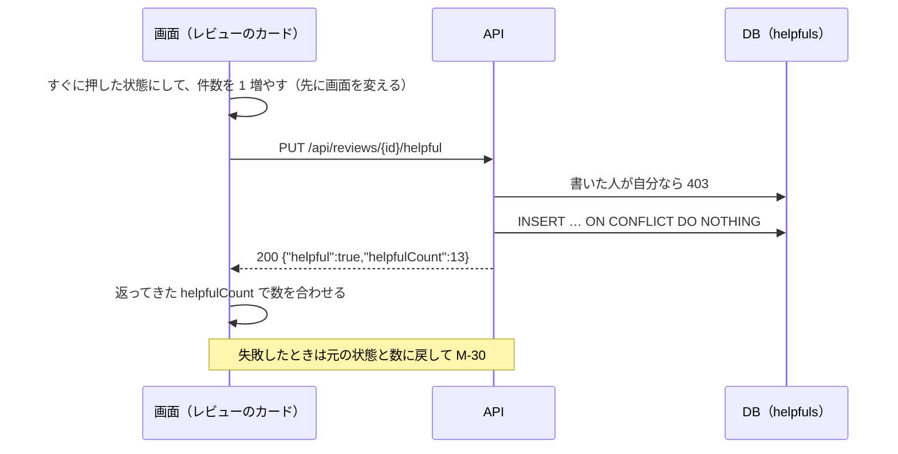

# 機能定義書 FN-05 参考になった：読書記録アプリ（BookLog）

| 項目 | 内容 |
| --- | --- |
| 文書番号 | BL-FD-05 |
| 版数 | 0.2 |
| 作成日 | 2026-11-01 |
| 最終更新日 | 2026-11-07 |
| 作成者 | （氏名） |
| 上位文書 | [機能定義書](function-definition.md)（BL-FD） |
| 状態 | 承認待ち |

## 改訂履歴

| 版数 | 日付 | 内容 | 作成者 |
| --- | --- | --- | --- |
| 0.1 | 2026-11-01 | 初版 | （氏名） |
| 0.2 | 2026-11-07 | 8 章の書いた人の「取り消す」を、6 章と実装（DELETE は 200）に合わせた | （氏名） |

本書は機能定義書の一部である。承認は[機能定義書](function-definition.md)で一括して行う。API とメッセージの共通の決まりは機能定義書 3 章・4 章のとおり。

---

## 1. 概要

| 項目 | 内容 |
| --- | --- |
| 目的 | ほかの人のレビューに「参考になった」の印を付け、その件数を誰でも見られるようにする |
| 使う画面 | レビューのカード（G-3・G-5・G-7・G-8）の「参考になった」ボタン |
| 関係する機能 | FN-03 レビュー（レビューを削除すると参考になったも消える）、FN-01 退会（その人が押したものを消す） |
| 前提 | 誰が押したかの一覧は出さない。件数だけを出す |

## 2. 機能要件

| ID | 内容 |
| --- | --- |
| H-1 | ほかの人のレビューのカードの「参考になった」を押すと、押した状態（色付き）に変え、件数を 1 増やす |
| H-2 | 押した状態のときにもう一度押すと取り消す。元の状態に戻し、件数を 1 減らす |
| H-3 | 参考になったは 1 人 1 レビューに 1 つまでとする。続けて何回押しても 2 つ以上にはならない |
| H-4 | 自分のレビューには付けられない。自分のレビューのカードでは件数だけを出し、ボタンは押せない |
| H-5 | 件数は、画面を表示した時点の値を出す。自分の操作はすぐに反映し、ほかの人の操作は画面を開き直したときに反映する。0 件のときも「0」と出す |

## 3. 処理の流れ

画面を先に変えるのは、押してから反映までを 0.5 秒以内（N-4）にするためである。押している間に続けて押されたときは、最後に押した状態だけを API に送る。

## 4. 入力の確認

なし（入力する項目がない）。

## 5. 業務ルール

| No | ルール |
| --- | --- |
| 1 | 参考になったは helpfuls の主キー（user_id, review_id）で 1 つに保つ。すでにあるときの PUT、ないときの DELETE はエラーにしない |
| 2 | PUT と DELETE は何回送っても同じ結果になる（冪等）。そのため、画面は失敗したときにそのまま送り直してよい |
| 3 | レビューを削除したら、そのレビューの参考になったも消える（ON DELETE CASCADE） |

## 6. API（案）

| メソッド | URL | 入力 | 出力（成功） | 主なエラー |
| --- | --- | --- | --- | --- |
| PUT | /api/reviews/{id}/helpful | なし | 200 `{"helpful":true,"helpfulCount":13}` | 403 CANNOT_MARK_OWN_REVIEW、404 REVIEW_NOT_FOUND |
| DELETE | /api/reviews/{id}/helpful | なし | 200 `{"helpful":false,"helpfulCount":12}` | 404 REVIEW_NOT_FOUND |

## 7. 使うデータ

| テーブル | 操作 | 内容 |
| --- | --- | --- |
| helpfuls | C R D | 押す・取り消す・件数 |
| reviews | R | レビューがあるか、書いた人 |

## 8. 権限

| 操作 | 書いた人 | ほかの人 |
| --- | --- | --- |
| 参考になったを付ける | できない（API は 403） | できる |
| 参考になったを取り消す | 付けられないので、取り消すものがない（API は 200 で何も変えない。5 章の 1） | できる |
| 件数を見る | できる | できる |

## 9. エラーとメッセージ

| 場面 | HTTP | code | メッセージ |
| --- | --- | --- | --- |
| 自分のレビューに付けようとした（画面を通さずに送った） | 403 | CANNOT_MARK_OWN_REVIEW | M-30 |
| レビューが削除されていた | 404 | REVIEW_NOT_FOUND | M-20。カードを一覧から消す |
| 付ける・取り消すのに失敗 | 500 | INTERNAL_ERROR | M-30。元の状態と数に戻す |

## 10. テストの観点

- TC-05-1：「参考になった」を 10 回素早く押しても、helpfuls の行は 0 か 1 で、最後に押した状態と合っている
- TC-05-2：2 つのブラウザで同じ人が同じレビューに付けても、行は 1 つ
- TC-05-3：自分のレビューではボタンが押せず、API に直接 PUT を送ると 403
- TC-05-4：API を止めた状態で押すと、元の状態と数に戻り M-30 が出る
- TC-05-5：レビューを削除すると helpfuls の行も消える。押した人が退会すると件数が減る
