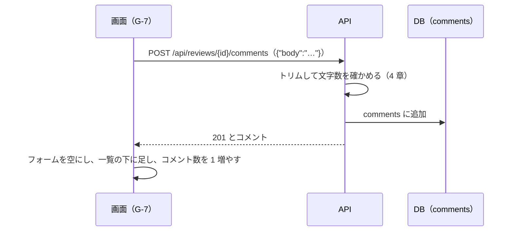

# 機能定義書 FN-06 コメント：読書記録アプリ（BookLog）

| 項目 | 内容 |
| --- | --- |
| 文書番号 | BL-FD-06 |
| 版数 | 0.1 |
| 作成日 | 2026-11-01 |
| 最終更新日 | 2026-11-01 |
| 作成者 | （氏名） |
| 上位文書 | [機能定義書](function-definition.md)（BL-FD） |
| 状態 | 承認待ち |

## 改訂履歴

| 版数 | 日付 | 内容 | 作成者 |
| --- | --- | --- | --- |
| 0.1 | 2026-11-01 | 初版 | （氏名） |

本書は機能定義書の一部である。承認は[機能定義書](function-definition.md)で一括して行う。API とメッセージの共通の決まりは機能定義書 3 章・4 章のとおり。

---

## 1. 概要

| 項目 | 内容 |
| --- | --- |
| 目的 | レビューに返信の文章（コメント）を付け、その中身と件数を誰でも見られるようにする |
| 使う画面 | G-7 レビューの詳細画面（コメントのフォーム・一覧）、レビューのカードのコメント数、G-12 確認ダイアログ |
| 関係する機能 | FN-03 レビュー（レビューを削除するとコメントも消える。ネタバレありのレビューではコメントも伏せる）、FN-01 退会（その人のコメントを消す） |
| 前提 | コメントへのコメントはできない。コメントの編集はできない（消して書き直す） |

## 2. 機能要件

| ID | 内容 |
| --- | --- |
| C-1 | G-7 のコメントのフォームに本文を入れて「コメントする」を押すと、コメントを付ける。付けた後はフォームを空にし、一覧の一番下に足し、コメント数を 1 増やす |
| C-2 | 本文はトリムした後で 1〜500 文字とする。入力欄の下に残りの文字数を出す。0 文字のとき、500 文字を超えたときは「コメントする」を押せない |
| C-3 | コメントは古い順に 50 件ずつ出す。一番下の「もっと見る」で次の 50 件を出す。1 件ごとに、書いた人の表示名・@ユーザー ID・日時・本文を出す |
| C-4 | 本文の改行はそのまま出す。URL はリンクにしない。HTML の記号はそのまま文字として出す（N-17） |
| C-5 | 自分のコメントにだけ「削除」を出す。押すと G-12 に M-24 を出し、「削除」で消してコメント数を 1 減らす |
| C-6 | ネタバレありのレビューでは、「ネタバレを表示」を押すまで、コメントの一覧とフォームを伏せる（FN-03 RV-11） |
| C-7 | コメントの書いた人の名前を押すと、その人のプロフィール（G-8）を開く |

## 3. 処理の流れ

送信中は「コメントする」を押せなくする（2 回押して 2 つ付かないようにする）。

## 4. 入力の確認

| 項目 | 型 | 必須 | 条件 | 守られないとき |
| --- | --- | --- | --- | --- |
| 本文（body） | 文字列 | ○ | トリム後、改行を LF にそろえて 1〜500 文字 | 画面では押せない。API は 0 文字で 400 COMMENT_REQUIRED、501 文字以上で 400 BAD_REQUEST |

## 5. 業務ルール

| No | ルール |
| --- | --- |
| 1 | 一覧は created_at の古い順。同じ日時のときは ID の小さい順。続きは「最後に出した行の日時と ID」で読む |
| 2 | レビューを削除したら、そのコメントも消える（ON DELETE CASCADE） |
| 3 | コメントを消せるのは、そのコメントを書いた人だけ。レビューを書いた人も、ほかの人のコメントは消せない |

## 6. API（案）

| メソッド | URL | 入力 | 出力（成功） | 主なエラー |
| --- | --- | --- | --- | --- |
| GET | /api/reviews/{id}/comments?cursor= | cursor | 200 `{"items":[コメント…],"nextCursor":…}` | 404 REVIEW_NOT_FOUND |
| POST | /api/reviews/{id}/comments | `{"body"}` | 201 コメント | 400、404 REVIEW_NOT_FOUND |
| DELETE | /api/comments/{id} | なし | 204 | 403、404 COMMENT_NOT_FOUND |

コメント：`{"id":901,"author":{"username":"hana","displayName":"はなこ"},"body":"…","mine":false,"createdAt":"…"}`

## 7. 使うデータ

| テーブル | 操作 | 内容 |
| --- | --- | --- |
| comments | C R D | コメントを付ける・一覧・件数・消す |
| reviews | R | レビューがあるか |
| users | R | 書いた人 |

## 8. 権限

| 操作 | コメントを書いた人 | レビューを書いた人 | ほかの人 |
| --- | --- | --- | --- |
| コメントを付ける | — | できる（自分のレビューにも） | できる |
| コメントを見る | できる | できる | できる |
| コメントを消す | できる | できない | できない（API は 403） |

## 9. エラーとメッセージ

| 場面 | HTTP | code | メッセージ |
| --- | --- | --- | --- |
| 本文が空（画面を通さずに送った） | 400 | COMMENT_REQUIRED | M-30 |
| レビューが削除されていた | 404 | REVIEW_NOT_FOUND | M-20 |
| コメントが削除されていた | 404 | COMMENT_NOT_FOUND | 一覧からそのコメントを消す |
| 他人のコメントを消そうとした | 403 | FORBIDDEN | M-30 |
| 付ける・消すのに失敗 | 500 | INTERNAL_ERROR | M-30。フォームの中身は残す |

## 10. テストの観点

- TC-06-1：本文：0 文字（空白・改行だけ）・1 文字・500 文字・501 文字
- TC-06-2：51 件のコメントがあるとき、50 件 → 「もっと見る」で 1 件出る。古い順に並ぶ
- TC-06-3：他人のコメントの DELETE を API に直接送ると 403。レビューを書いた人でも 403
- TC-06-4：コメントを付ける・消すと、G-7 とカードのコメント数が合う
- TC-06-5：ネタバレありのレビューの G-7 では、「ネタバレを表示」を押すまでコメントもフォームも見えない
- TC-06-6：本文に `<b>太字</b>` を入れても文字のまま出る
- TC-06-7：レビューを削除するとコメントも消える。コメントした人が退会するとそのコメントが消える
