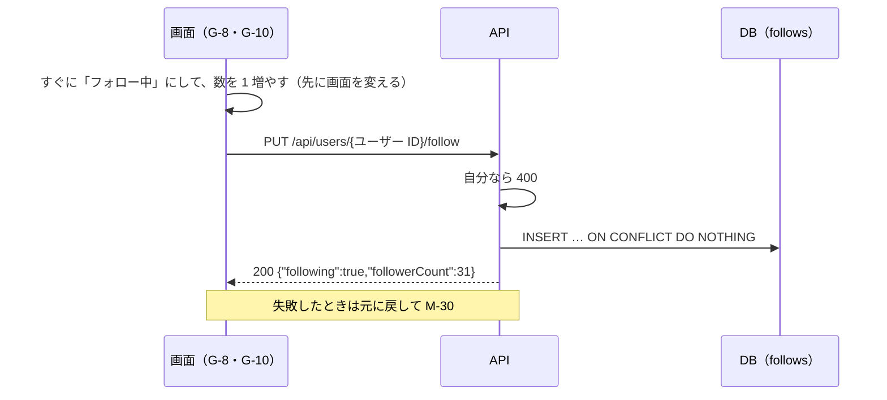

# 機能定義書 FN-07 フォロー：読書記録アプリ（BookLog）

| 項目 | 内容 |
| --- | --- |
| 文書番号 | BL-FD-07 |
| 版数 | 0.1 |
| 作成日 | 2026-11-01 |
| 最終更新日 | 2026-11-01 |
| 作成者 | （氏名） |
| 上位文書 | [機能定義書](function-definition.md)（BL-FD） |
| 状態 | 承認待ち |

## 改訂履歴

| 版数 | 日付 | 内容 | 作成者 |
| --- | --- | --- | --- |
| 0.1 | 2026-11-01 | 初版 | （氏名） |

本書は機能定義書の一部である。承認は[機能定義書](function-definition.md)で一括して行う。API とメッセージの共通の決まりは機能定義書 3 章・4 章のとおり。

---

## 1. 概要

| 項目 | 内容 |
| --- | --- |
| 目的 | 読書仲間をフォローし、その人のレビューをタイムラインの「フォロー中」タブで読めるようにする |
| 使う画面 | G-8 プロフィール画面（フォローボタン・件数）、G-10 フォロー中・フォロワーの一覧画面 |
| 関係する機能 | FN-09 タイムライン（「フォロー中」の対象）、FN-11 プロフィール、FN-01 退会（その人のフォローを消す） |
| 前提 | 相手の承認はいらない。フォローされたことは知らせない（要件定義書 2.2） |

## 2. 機能要件

| ID | 内容 |
| --- | --- |
| F-1 | ほかの人のプロフィール（G-8）の「フォローする」を押すとフォローする。ボタンを「フォロー中」に変え、相手のフォロワー数を 1 増やす |
| F-2 | 「フォロー中」を押すとフォローを解除する（確認は出さない）。ボタンを「フォローする」に戻し、フォロワー数を 1 減らす |
| F-3 | 自分はフォローできない。自分のプロフィールにはフォローボタンの代わりに「プロフィールを編集」を出す |
| F-4 | 同じ人を 2 回以上フォローしても、フォローは 1 つにまとめる |
| F-5 | G-8 のフォロー数・フォロワー数を押すと、G-10 の「フォロー中」「フォロワー」のタブを開く。新しくフォローした順に 20 件ずつ出し、一番下までスクロールすると次の 20 件を出す |
| F-6 | G-10 の一覧の各行には、表示名・@ユーザー ID・自己紹介の 1 行目とフォローボタンを出す（自分の行には出さない）。名前を押すとその人の G-8 を開く |
| F-7 | 存在しないユーザーの G-10 を開いたときは M-28 を出す |

## 3. 処理の流れ

押している間に続けて押されたときは、最後に押した状態だけを API に送る。

## 4. 入力の確認

なし（入力する項目がない）。

## 5. 業務ルール

| No | ルール |
| --- | --- |
| 1 | フォローは follows の主キー（follower_id, followee_id）で 1 つに保つ。自分自身へのフォローはデータベースの制約でも防ぐ |
| 2 | PUT と DELETE は何回送っても同じ結果になる（冪等） |
| 3 | 一覧は created_at の新しい順。同じ日時のときはユーザーの ID の大きい順。続きは「最後に出した行の日時と ID」で読む |
| 4 | どちらかが退会したら、そのフォローも消える（ON DELETE CASCADE） |

## 6. API（案）

| メソッド | URL | 入力 | 出力（成功） | 主なエラー |
| --- | --- | --- | --- | --- |
| PUT | /api/users/{ユーザー ID}/follow | なし | 200 `{"following":true,"followerCount":31}` | 400 CANNOT_FOLLOW_SELF、404 USER_NOT_FOUND |
| DELETE | /api/users/{ユーザー ID}/follow | なし | 200 `{"following":false,"followerCount":30}` | 404 USER_NOT_FOUND |
| GET | /api/users/{ユーザー ID}/following?cursor= | cursor | 200 `{"items":[UserSummary…],"nextCursor":…}` | 404 USER_NOT_FOUND |
| GET | /api/users/{ユーザー ID}/followers?cursor= | cursor | 200 `{"items":[UserSummary…],"nextCursor":…}` | 404 USER_NOT_FOUND |

UserSummary の形は機能定義書 3.5 のとおり。

## 7. 使うデータ

| テーブル | 操作 | 内容 |
| --- | --- | --- |
| follows | C R D | フォロー・解除・一覧・件数 |
| users | R | 相手がいるか、一覧のユーザー |

## 8. 権限

| 操作 | ログインしている人 |
| --- | --- |
| ほかの人をフォロー・解除する | できる |
| 自分をフォローする | できない |
| 誰のフォロー中・フォロワーの一覧も見る | できる |
| ほかの人のフォローを変える | できない |

## 9. エラーとメッセージ

| 場面 | HTTP | code | メッセージ |
| --- | --- | --- | --- |
| 自分をフォローしようとした（画面を通さずに送った） | 400 | CANNOT_FOLLOW_SELF | M-30 |
| ユーザーがいない（退会した） | 404 | USER_NOT_FOUND | M-28 |
| フォロー・解除に失敗 | 500 | INTERNAL_ERROR | M-30。ボタンと数を元に戻す |
| 一覧の読み込みに失敗 | 500 | INTERNAL_ERROR | M-29 と「再読み込み」 |

## 10. テストの観点

- TC-07-1：フォロー → G-8 のフォロワー数と相手の G-10 の一覧に出る。解除で元に戻る
- TC-07-2：「フォローする」を 10 回素早く押しても、follows の行は 0 か 1 で、最後に押した状態と合っている
- TC-07-3：自分の G-8 にはフォローボタンが出ない。API で自分に PUT を送ると 400
- TC-07-4：21 人フォローしているとき、20 人 → 1 人と読める。新しい順に並ぶ
- TC-07-5：存在しないユーザーの /users/nobody/following を開くと M-28
- TC-07-6：フォローした人が退会すると、フォロー数が減り一覧から消える
