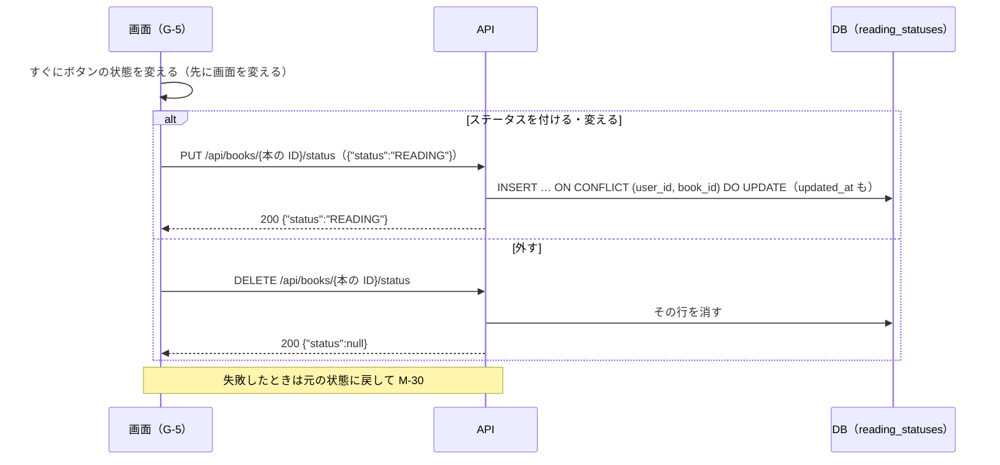

# 機能定義書 FN-08 読書ステータス・本棚：読書記録アプリ（BookLog）

| 項目 | 内容 |
| --- | --- |
| 文書番号 | BL-FD-08 |
| 版数 | 0.1 |
| 作成日 | 2026-11-01 |
| 最終更新日 | 2026-11-01 |
| 作成者 | （氏名） |
| 上位文書 | [機能定義書](function-definition.md)（BL-FD） |
| 状態 | 承認待ち |

## 改訂履歴

| 版数 | 日付 | 内容 | 作成者 |
| --- | --- | --- | --- |
| 0.1 | 2026-11-01 | 初版 | （氏名） |

本書は機能定義書の一部である。承認は[機能定義書](function-definition.md)で一括して行う。API とメッセージの共通の決まりは機能定義書 3 章・4 章のとおり。

---

## 1. 概要

| 項目 | 内容 |
| --- | --- |
| 目的 | 本ごとに「読みたい」「読書中」「読了」を付け、自分の本棚として見られるようにする。ほかの人の本棚も見られる |
| 使う画面 | G-5 本のページ（ステータスのボタン）、G-8 プロフィール画面の「本棚」タブ |
| 関係する機能 | FN-03 レビュー（レビューを書くと「読了」で入る）、FN-10 本のページ、FN-11 プロフィール、FN-01 退会（その人の本棚を消す） |
| 前提 | ステータスは 3 つだけ。読んだページ数・読み終えた日は記録しない（要件定義書 2.2） |

## 2. 機能要件

| ID | 内容 |
| --- | --- |
| ST-1 | 本のページ（G-5）に「読みたい」「読書中」「読了」の 3 つのボタンを並べ、今のステータスのボタンを選んだ状態（色付き）で出す。本棚にない本では、どれも選んでいない状態で出す |
| ST-2 | 選んでいないボタンを押すと、その本をそのステータスで本棚に入れる（すでに別のステータスなら変える） |
| ST-3 | 選んでいるボタンをもう一度押すと、ステータスを外し、本棚からその本をなくす。確認は出さない。レビューは消さない |
| ST-4 | G-8 の「本棚」タブには、「読書中」「読了」「読みたい」の 3 つの小さなタブを、それぞれの冊数つきで出す。初めに開くのは「読書中」 |
| ST-5 | 本棚の一覧は、ステータスを付けた（変えた）日時の新しい順に 20 冊ずつ出し、一番下までスクロールすると次の 20 冊を出す。1 冊ごとに表紙・書名・著者と、その人がその本に書いたレビューの星（あれば）を出す。押すと G-5 を開く |
| ST-6 | 本棚が空のときは M-27 を出す |
| ST-7 | 本棚は誰でも見られる。ステータスを変えられるのは自分の本棚だけ |
| ST-8 | ボタンを押すと、すぐに画面を変える。失敗したときは元の状態に戻して M-30 を出す |

## 3. 処理の流れ

押してから反映までを 0.5 秒以内（N-4）にするため、画面を先に変える。続けて押されたときは、最後の状態だけを API に送る。

## 4. 入力の確認

| 項目 | 型 | 必須 | 条件 | 守られないとき |
| --- | --- | --- | --- | --- |
| ステータス（status） | 文字列 | ○ | WANT（読みたい）・READING（読書中）・READ（読了）のどれか | 400 BAD_REQUEST |
| 本棚のタブ（status） | 文字列 | ○ | 同上 | 400 BAD_REQUEST |

## 5. 業務ルール

| No | ルール |
| --- | --- |
| 1 | 読書ステータスは reading_statuses の主キー（user_id, book_id）で 1 冊に 1 つに保つ |
| 2 | PUT と DELETE は何回送っても同じ結果になる（冪等） |
| 3 | 同じステータスで PUT を送ったときは、updated_at を変えない（本棚の並び順を変えない） |
| 4 | レビューを書いたときの自動の追加は FN-03 RV-5 のとおり。レビューを削除しても本棚はそのまま |
| 5 | 本棚の一覧は updated_at の新しい順。同じ日時のときは本の ID の大きい順。続きは「最後に出した行の日時と本の ID」で読む |

## 6. API（案）

| メソッド | URL | 入力 | 出力（成功） | 主なエラー |
| --- | --- | --- | --- | --- |
| PUT | /api/books/{本の ID}/status | `{"status"}` | 200 `{"status":"READING"}` | 400、404 BOOK_NOT_FOUND |
| DELETE | /api/books/{本の ID}/status | なし | 200 `{"status":null}` | 404 BOOK_NOT_FOUND |
| GET | /api/users/{ユーザー ID}/bookshelf?status=&cursor= | ステータス、cursor | 200 `{"items":[本棚の 1 冊…],"nextCursor":…}` | 400、404 USER_NOT_FOUND |

本棚の 1 冊：`{"book":BookSummary,"status":"READ","rating":4,"updatedAt":"…"}`。rating はその人がその本に書いたレビューの星で、なければ null。3 つのタブの冊数は GET /api/users/{ユーザー ID}（FN-11）で返す。

## 7. 使うデータ

| テーブル | 操作 | 内容 |
| --- | --- | --- |
| reading_statuses | C R U D | ステータスを付ける・変える・外す、本棚の一覧・冊数 |
| books | R | 本があるか、一覧の本の情報 |
| reviews | R | 一覧の星 |

## 8. 権限

| 操作 | 本人 | ほかの人 |
| --- | --- | --- |
| ステータスを付ける・変える・外す | できる | できない |
| 本棚を見る | できる | できる |

## 9. エラーとメッセージ

| 場面 | HTTP | code | メッセージ |
| --- | --- | --- | --- |
| 本がない | 404 | BOOK_NOT_FOUND | M-15 |
| ユーザーがいない | 404 | USER_NOT_FOUND | M-28 |
| 付ける・変える・外すのに失敗 | 500 | INTERNAL_ERROR | M-30。ボタンを元に戻す |
| 一覧の読み込みに失敗 | 500 | INTERNAL_ERROR | M-29 と「再読み込み」 |

## 10. テストの観点

- TC-08-1：「読みたい」→「読書中」→「読了」と押すと、本棚の行は 1 つのままステータスが変わり、G-8 の冊数が合う
- TC-08-2：選んでいる「読了」を押すと本棚から消え、レビューは残る
- TC-08-3：同じステータスの PUT を 2 回送っても、本棚の並び順が変わらない
- TC-08-4：ボタンを 10 回素早く押しても、最後に押した状態と合っている
- TC-08-5：21 冊あるとき、20 冊 → 1 冊と読める。ステータスを変えた本が一覧の先頭に来る
- TC-08-6：レビューを書いた本には星が出て、書いていない本には出ない
- TC-08-7：ほかの人の本棚は見られるが、API で他人の本棚を変える方法がない（PUT はログインした人の本棚だけを変える）
- TC-08-8：空の本棚のタブで M-27
