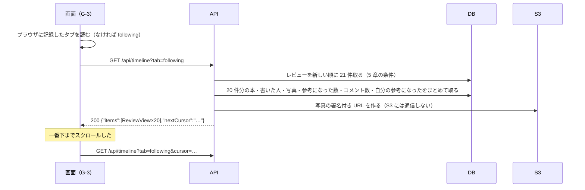

# 機能定義書 FN-09 タイムライン：読書記録アプリ（BookLog）

| 項目 | 内容 |
| --- | --- |
| 文書番号 | BL-FD-09 |
| 版数 | 0.1 |
| 作成日 | 2026-11-01 |
| 最終更新日 | 2026-11-01 |
| 作成者 | （氏名） |
| 上位文書 | [機能定義書](function-definition.md)（BL-FD） |
| 状態 | 承認待ち |

## 改訂履歴

| 版数 | 日付 | 内容 | 作成者 |
| --- | --- | --- | --- |
| 0.1 | 2026-11-01 | 初版 | （氏名） |

本書は機能定義書の一部である。承認は[機能定義書](function-definition.md)で一括して行う。API とメッセージの共通の決まりは機能定義書 3 章・4 章のとおり。

---

## 1. 概要

| 項目 | 内容 |
| --- | --- |
| 目的 | 自分とフォローした人のレビュー、または全員のレビューを、新しい順に読めるようにする |
| 使う画面 | G-3 タイムライン画面 |
| 関係する機能 | FN-03 レビュー（レビューのカード）、FN-04 写真、FN-05 参考になった、FN-07 フォロー（「フォロー中」の対象） |
| 前提 | レビューのカードの中身と操作は FN-03・FN-04・FN-05 で定める。本書は一覧の出し方だけを定める |

## 2. 機能要件

| ID | 内容 |
| --- | --- |
| T-1 | タイムライン画面（G-3）に「フォロー中」「すべて」の 2 つのタブを出す。「フォロー中」には自分とフォローしている人のレビューを、「すべて」には全ユーザーのレビューを出す |
| T-2 | レビューは投稿した日時の新しい順に 20 件ずつ出す。一番下までスクロールすると、次の 20 件を読み込んで続けて出す。読み込んでいる間は一覧の下に「読み込み中…」と出す |
| T-3 | G-3 を開いたときは、前回最後に選んでいたタブを出す。初めて開いたときは「フォロー中」を出す。どのタブを選んだかはブラウザに記録する |
| T-4 | 「フォロー中」タブで、誰もフォローしておらず自分のレビューもないときは、一覧の代わりに M-25 を出す |
| T-5 | 編集したレビューの位置は変えない（投稿した日時で並べる） |
| T-6 | ほかの人の新しいレビューを自動では足さない。タブを押し直すか、画面を読み込み直すと、最新の 20 件から出し直す |
| T-7 | 読み込んでいる途中にほかの人が投稿しても、同じレビューを 2 回出したり、抜かしたりしない |
| T-8 | 読み込みに失敗したときは M-29 と「再読み込み」ボタンを出す。「再読み込み」で同じ読み込みをやり直す |

## 3. 処理の流れ

21 件取るのは、次があるか（nextCursor を返すか）を知るためである。件数やカードの情報は 1 件ずつではなく、20 件分をまとめて取る（N+1 を避けて N-2 を守るため）。

## 4. 入力の確認

| 項目 | 型 | 必須 | 条件 | 守られないとき |
| --- | --- | --- | --- | --- |
| タブ（tab） | 文字列 | ○ | following か all | 400 BAD_REQUEST |
| cursor | 文字列 | | 前回の nextCursor | 読めないときは 400 BAD_REQUEST |

## 5. 業務ルール

| No | ルール |
| --- | --- |
| 1 | 「フォロー中」は、書いた人が自分か、自分がフォローしている人のレビュー |
| 2 | 並び順はレビューの ID の大きい順（新しいほど大きい。データ要件定義書 3 章）。続きは「最後に出した行の ID より小さいもの」を読む。これで途中に投稿があっても重ならず、抜けない（T-7） |
| 3 | ネタバレありのレビューも一覧に出し、画面で伏せる（FN-03 RV-11） |

## 6. API（案）

| メソッド | URL | 入力 | 出力（成功） | 主なエラー |
| --- | --- | --- | --- | --- |
| GET | /api/timeline?tab=&cursor= | タブ、cursor | 200 `{"items":[ReviewView…],"nextCursor":…}` | 400 |

ReviewView の形は機能定義書 3.5 のとおり。

## 7. 使うデータ

| テーブル | 操作 | 内容 |
| --- | --- | --- |
| reviews | R | 一覧 |
| follows | R | 「フォロー中」の対象 |
| books・users・review_photos・helpfuls・comments | R | カードの中身・件数 |

## 8. 権限

| 操作 | ログインしている人 |
| --- | --- |
| 「フォロー中」「すべて」を見る | できる |

## 9. エラーとメッセージ

| 場面 | HTTP | code | メッセージ |
| --- | --- | --- | --- |
| 「フォロー中」に出すものがない | 200 | — | M-25 |
| 読み込みに失敗 | 500 | INTERNAL_ERROR | M-29 と「再読み込み」 |

## 10. テストの観点

- TC-09-1：「フォロー中」には自分とフォローした人のレビューだけが、「すべて」には全員のレビューが出る
- TC-09-2：41 件あるとき、20 → 40 → 41 件と読め、重なりも抜けもない。読み込みの途中でほかの人が投稿しても同じ
- TC-09-3：タブを切り替えて画面を読み込み直すと、最後に選んだタブが出る。初めては「フォロー中」
- TC-09-4：誰もフォローしておらず自分のレビューもないとき M-25
- TC-09-5：編集したレビューの位置が変わらない
- TC-09-6：20 件を出すときのデータベースへの問い合わせの回数が、件数によって増えない（N+1 がない）
- TC-09-7：API を止めた状態でスクロールすると M-29 と「再読み込み」が出て、押すと続きが読める
