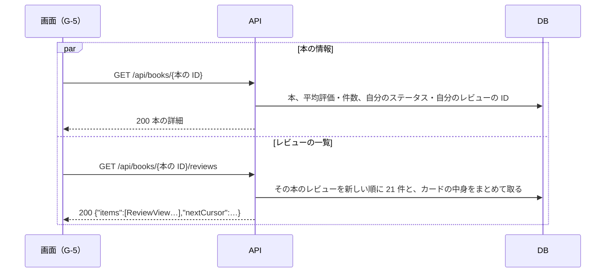

# 機能定義書 FN-10 本のページ：読書記録アプリ（BookLog）

| 項目 | 内容 |
| --- | --- |
| 文書番号 | BL-FD-10 |
| 版数 | 0.2 |
| 作成日 | 2026-11-01 |
| 最終更新日 | 2026-11-07 |
| 作成者 | （氏名） |
| 上位文書 | [機能定義書](function-definition.md)（BL-FD） |
| 状態 | 承認待ち |

## 改訂履歴

| 版数 | 日付 | 内容 | 作成者 |
| --- | --- | --- | --- |
| 0.1 | 2026-11-01 | 初版 | （氏名） |
| 0.2 | 2026-11-07 | 4 章の本の ID を実装に合わせた（整数でないときの API は 400） | （氏名） |

本書は機能定義書の一部である。承認は[機能定義書](function-definition.md)で一括して行う。API とメッセージの共通の決まりは機能定義書 3 章・4 章のとおり。

---

## 1. 概要

| 項目 | 内容 |
| --- | --- |
| 目的 | 1 冊の本の情報と、その本を読んだ人たちのレビュー・平均評価をまとめて見られるようにする |
| 使う画面 | G-5 本のページ |
| 関係する機能 | FN-02 書籍検索・登録（取り込んだ本を開く）、FN-03 レビュー（「レビューを書く」とレビューのカード）、FN-08 読書ステータス（ステータスのボタン） |
| 前提 | 本の情報はデータベースに保存したものを出し、Google Books API は呼ばない（要件定義書 P-4）。そのため Google Books API が使えなくても開ける（N-8） |

## 2. 機能要件

| ID | 内容 |
| --- | --- |
| BK-1 | G-5 の上に、表紙・書名・著者・出版社・出版日・ISBN を出す。ない項目は行ごと出さない。表紙がない本は「表紙なし」の枠を出す |
| BK-2 | 紹介文があれば、5 行まで出し、「続きを読む」で全部出す |
| BK-3 | 平均評価（星と小数点以下 1 桁の数字。例：★★★★☆ 4.2）と、レビューの件数を出す。レビューが 0 件のときは平均評価を「—」と出す |
| BK-4 | 自分の読書ステータスのボタン（FN-08 ST-1）と、「レビューを書く」または「レビューを編集」（FN-03 RV-1）を出す |
| BK-5 | その本のレビューを新しい順に 20 件ずつ出し、一番下までスクロールすると次の 20 件を出す。レビューのカードでは、本の表紙・書名は出さない（同じ本のため） |
| BK-6 | レビューが 0 件のときは、一覧の代わりに M-26 を出す |
| BK-7 | 存在しない本の G-5 を開いたときは M-15 を出す |

## 3. 処理の流れ



2 つの API を同時に呼び、N-3（2 秒以内）を守る。

## 4. 入力の確認

| 項目 | 型 | 必須 | 条件 | 守られないとき |
| --- | --- | --- | --- | --- |
| 本の ID | 数値 | ○ | 1 以上の整数 | 画面は API を呼ばずに M-15。API は、整数でなければ 400 BAD_REQUEST、ない本は 404 BOOK_NOT_FOUND |
| cursor | 文字列 | | 前回の nextCursor | 400 BAD_REQUEST |

## 5. 業務ルール

| No | ルール |
| --- | --- |
| 1 | 平均評価は、その本のレビューの星の平均を小数点以下 2 桁目で四捨五入する（例：4.25 → 4.3）。星の形は、平均を四捨五入した整数の数だけ塗る |
| 2 | 平均評価と件数は、開いたときにデータベースから数える（保存しておかない）。本 1 冊のレビューは多くても数十件のため |
| 3 | レビューの並び順・続きの読み方は FN-09 の 5 章の 2 と同じ |

## 6. API（案）

| メソッド | URL | 入力 | 出力（成功） | 主なエラー |
| --- | --- | --- | --- | --- |
| GET | /api/books/{本の ID} | なし | 200 本の詳細 | 404 BOOK_NOT_FOUND |
| GET | /api/books/{本の ID}/reviews?cursor= | cursor | 200 `{"items":[ReviewView…],"nextCursor":…}` | 404 BOOK_NOT_FOUND |

本の詳細：

```json
{
  "id": 56,
  "title": "本の題名",
  "authors": ["著者名"],
  "publisher": "出版社",
  "publishedDate": "2024-05",
  "isbn13": "9784…",
  "description": "紹介文…",
  "thumbnailUrl": "https://books.google.com/…",
  "averageRating": 4.2,
  "reviewCount": 5,
  "myStatus": "READING",
  "myReviewId": null
}
```

averageRating はレビューが 0 件なら null。myStatus は本棚にないなら null。myReviewId はまだ書いていないなら null。

## 7. 使うデータ

| テーブル | 操作 | 内容 |
| --- | --- | --- |
| books | R | 本の情報 |
| reviews | R | 平均評価・件数・一覧・自分のレビュー |
| reading_statuses | R | 自分のステータス |
| users・review_photos・helpfuls・comments | R | カードの中身・件数 |

## 8. 権限

| 操作 | ログインしている人 |
| --- | --- |
| 本のページを見る | できる |

## 9. エラーとメッセージ

| 場面 | HTTP | code | メッセージ |
| --- | --- | --- | --- |
| 本がない | 404 | BOOK_NOT_FOUND | M-15 |
| レビューがない | 200 | — | M-26 |
| 読み込みに失敗 | 500 | INTERNAL_ERROR | M-29 と「再読み込み」 |

## 10. テストの観点

- TC-10-1：星 4・4・5 の本の平均が 4.3、星 1 つだけの本が 1.0、レビュー 0 件の本が「—」
- TC-10-2：レビューを書く・消すと、平均評価と件数が変わる
- TC-10-3：出版社・ISBN・紹介文・表紙がない本で、その行が出ない／「表紙なし」が出る
- TC-10-4：自分のステータス・「レビューを書く」と「レビューを編集」の切り替えが合う
- TC-10-5：Google Books API が使えない状態でも、取り込んだ本の G-5 が開ける
- TC-10-6：/books/999999 を開くと M-15
- TC-10-7：紹介文に HTML の記号があっても文字のまま出る
