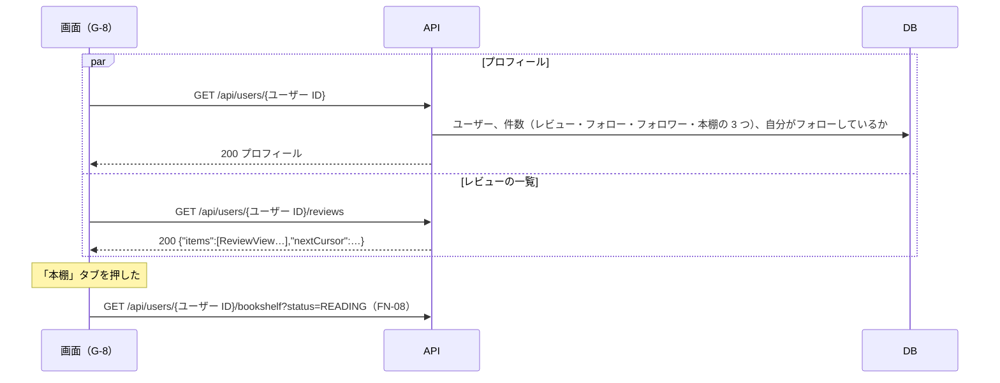

# 機能定義書 FN-11 プロフィール：読書記録アプリ（BookLog）

| 項目 | 内容 |
| --- | --- |
| 文書番号 | BL-FD-11 |
| 版数 | 0.1 |
| 作成日 | 2026-11-01 |
| 最終更新日 | 2026-11-01 |
| 作成者 | （氏名） |
| 上位文書 | [機能定義書](function-definition.md)（BL-FD） |
| 状態 | 承認待ち |

## 改訂履歴

| 版数 | 日付 | 内容 | 作成者 |
| --- | --- | --- | --- |
| 0.1 | 2026-11-01 | 初版 | （氏名） |

本書は機能定義書の一部である。承認は[機能定義書](function-definition.md)で一括して行う。API とメッセージの共通の決まりは機能定義書 3 章・4 章のとおり。

---

## 1. 概要

| 項目 | 内容 |
| --- | --- |
| 目的 | ユーザーの情報、レビューの一覧、本棚を 1 つの画面で見られるようにする。自分の表示名と自己紹介を変えられるようにする |
| 使う画面 | G-8 プロフィール画面、G-9 プロフィールの編集画面 |
| 関係する機能 | FN-07 フォロー（フォローボタン・件数）、FN-08 本棚（「本棚」タブ）、FN-03 レビュー（「レビュー」タブのカード）、FN-01 退会（G-9 の「退会する」） |
| 前提 | アイコン画像はない。表示名の頭文字を丸の中に出す（要件定義書 2.2） |

## 2. 機能要件

| ID | 内容 |
| --- | --- |
| PF-1 | ヘッダーの「プロフィール」、またはレビュー・コメント・一覧の名前を押すと、その人のプロフィール画面（G-8）を開く |
| PF-2 | G-8 の上に、頭文字の丸・表示名・@ユーザー ID・自己紹介・レビューの件数・フォロー数・フォロワー数を出す。自己紹介の改行はそのまま出す |
| PF-3 | ほかの人の G-8 にはフォローボタン（FN-07）を、自分の G-8 には「プロフィールを編集」を出す |
| PF-4 | G-8 に「レビュー」「本棚」の 2 つのタブを出す。初めに開くのは「レビュー」。「レビュー」にはその人のレビューを新しい順に 20 件ずつ出す。「本棚」は FN-08 の ST-4〜ST-6 のとおり |
| PF-5 | 存在しないユーザー（退会した人を含む）の G-8 を開いたときは M-28 を出す |
| PF-6 | 「プロフィールを編集」を押すと G-9 を開き、今の表示名と自己紹介を入れておく。「保存する」で変えて G-8 に戻る。「キャンセル」では変えずに戻る。何も変えていないときは「保存する」を押せない |
| PF-7 | 表示名はトリムした後で 1〜30 文字、自己紹介は 0〜160 文字とする。表示名が 0 文字のときは M-5 を出す。上限を超えて入力はできない |
| PF-8 | G-9 のいちばん下に「退会する」を出す（FN-01 A-10） |

## 3. 処理の流れ



## 4. 入力の確認

| 項目 | 型 | 必須 | 条件 | 守られないとき |
| --- | --- | --- | --- | --- |
| 表示名 | 文字列 | ○ | トリム後 1〜30 文字 | M-5（API は 400 DISPLAY_NAME_REQUIRED） |
| 自己紹介 | 文字列 | | トリム後、改行を LF にそろえて 0〜160 文字 | 画面では入力できない（API は 400 BAD_REQUEST） |

## 5. 業務ルール

| No | ルール |
| --- | --- |
| 1 | 件数は開いたときにデータベースから数える |
| 2 | レビューの並び順・続きの読み方は FN-09 の 5 章の 2 と同じ |
| 3 | ユーザー ID は変えられない（FN-01 A-2） |
| 4 | 自己紹介の 1 行目（UserSummary の bioFirstLine）は、最初の改行の前まで。60 文字を超えるときは画面で「…」で切る |

## 6. API（案）

| メソッド | URL | 入力 | 出力（成功） | 主なエラー |
| --- | --- | --- | --- | --- |
| GET | /api/users/{ユーザー ID} | なし | 200 プロフィール | 404 USER_NOT_FOUND |
| GET | /api/users/{ユーザー ID}/reviews?cursor= | cursor | 200 `{"items":[ReviewView…],"nextCursor":…}` | 404 USER_NOT_FOUND |
| PATCH | /api/me/profile | `{"displayName","bio"}` | 200 プロフィール | 400 |

プロフィール：

```json
{
  "username": "taro_y",
  "displayName": "たろう",
  "bio": "ミステリーをよく読みます\n…",
  "reviewCount": 12,
  "followingCount": 8,
  "followerCount": 30,
  "bookshelfCounts": { "WANT": 5, "READING": 2, "READ": 14 },
  "followedByMe": false,
  "me": false
}
```

## 7. 使うデータ

| テーブル | 操作 | 内容 |
| --- | --- | --- |
| users | R U | プロフィールの表示・表示名と自己紹介の変更 |
| reviews・follows・reading_statuses | R | 件数、レビューの一覧 |

## 8. 権限

| 操作 | 本人 | ほかの人 |
| --- | --- | --- |
| プロフィールを見る | できる | できる |
| 表示名・自己紹介を変える | できる | できない（PATCH はログインした人のプロフィールだけを変える） |

## 9. エラーとメッセージ

| 場面 | HTTP | code | メッセージ |
| --- | --- | --- | --- |
| ユーザーがいない | 404 | USER_NOT_FOUND | M-28 |
| 表示名が空 | 400 | DISPLAY_NAME_REQUIRED | M-5 |
| 画面を通さずに送られた、条件に合わない入力（自己紹介が 161 文字など） | 400 | BAD_REQUEST | 入力が正しくありません。 |
| 保存に失敗 | 500 | INTERNAL_ERROR | M-30。入力した中身は残す |
| 読み込みに失敗 | 500 | INTERNAL_ERROR | M-29 と「再読み込み」 |

## 10. テストの観点

- TC-11-1：G-8 の件数（レビュー・フォロー・フォロワー・本棚の 3 つ）が、データベースの件数と合う
- TC-11-2：自分の G-8 には「プロフィールを編集」、ほかの人の G-8 にはフォローボタンが出る
- TC-11-3：表示名：0 文字（空白だけ）・1 文字・30 文字。自己紹介：0 文字・160 文字・161 文字（API に直接）
- TC-11-4：表示名を変えると、その人のレビュー・コメントのカードの名前も変わる
- TC-11-5：/users/nobody と、退会した人の G-8 を開くと M-28
- TC-11-6：自己紹介に `<script>` を入れても文字のまま出る。改行がそのまま出る
