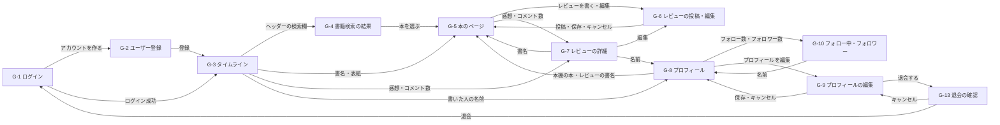

# 画面一覧：読書記録アプリ（BookLog）

| 項目 | 内容 |
| --- | --- |
| 文書番号 | BL-REQ-SCR |
| 版数 | 0.2 |
| 作成日 | 2026-11-01 |
| 最終更新日 | 2026-11-01 |
| 作成者 | （氏名） |
| 上位文書 | [要件定義書](requirements.md)（BL-REQ） |
| 状態 | 承認待ち |

## 改訂履歴

| 版数 | 日付 | 内容 | 作成者 |
| --- | --- | --- | --- |
| 0.1 | 2026-11-01 | 初版 | （氏名） |
| 0.2 | 2026-11-01 | 退会（要件定義書 U-4）に合わせて G-9 に「退会する」を足し、退会の確認ダイアログ（G-13）を追加した。ネタバレ（U-5）に合わせて G-3・G-5・G-7 の内容と G-3 のイメージを直した | （氏名） |

本書は要件定義書の一部である。承認は[要件定義書](requirements.md)で一括して行い、変更は要件定義書 16 章の手続きで行う。

本書では、どんな画面があり、どうつながるかを定める。画面ごとの細かい見た目・動き（大きさ、色、操作ごとの結果など）は画面設計書で定める。

---

## 1. 画面一覧

| 画面 ID | 画面名 | URL | 内容 | 主な機能 |
| --- | --- | --- | --- | --- |
| G-1 | ログイン画面 | /login | ユーザー ID とパスワードでログインする | FN-01 |
| G-2 | ユーザー登録画面 | /signup | アカウントを作る | FN-01 |
| G-3 | タイムライン画面 | / | 「フォロー中」「すべて」のタブと、レビューの一覧 | FN-09、FN-05 |
| G-4 | 書籍検索の結果画面 | /books/search?q={検索した文字} | ISBN・書名で探した本の一覧。選ぶと G-5 | FN-02 |
| G-5 | 本のページ | /books/{本の ID} | 本の情報、平均評価、自分の読書ステータス、「レビューを書く」、その本のレビューの一覧 | FN-10、FN-08、FN-05 |
| G-6 | レビューの投稿・編集画面 | /books/{本の ID}/review | 星・感想・写真・「ネタバレあり」の印を入れて投稿する。すでに書いた本では、そのレビューを編集する | FN-03、FN-04 |
| G-7 | レビューの詳細画面 | /reviews/{レビュー ID} | 1 つのレビューと写真、参考になった、コメントのフォーム・一覧。自分のレビューはここで編集・削除できる。ネタバレありのレビューは、感想・写真・コメントを伏せて出す | FN-03〜FN-06 |
| G-8 | プロフィール画面 | /users/{ユーザー ID} | ユーザーの情報、フォローボタン、「レビュー」「本棚」のタブ。本棚は「読書中」「読了」「読みたい」に分けて出す | FN-11、FN-07、FN-08 |
| G-9 | プロフィールの編集画面 | /settings/profile | 表示名・自己紹介を変える。いちばん下に「退会する」を置く | FN-11、FN-01 |
| G-10 | フォロー中・フォロワーの一覧画面 | /users/{ユーザー ID}/following、/users/{ユーザー ID}/followers | 「フォロー中」「フォロワー」のタブとユーザーの一覧 | FN-07 |
| G-11 | 写真の拡大ダイアログ | （G-3・G-5・G-7・G-8 の上に重ねる） | レビューの写真を大きく出す | FN-04 |
| G-12 | 確認ダイアログ | （G-3・G-5・G-7・G-8 の上に重ねる） | レビュー・コメントを削除する前に確認する | FN-03、FN-06 |
| G-13 | 退会の確認ダイアログ | （G-9 の上に重ねる） | 消えるデータを示し、パスワードを入れ直して退会する。退会したら G-1 に移る | FN-01 |

G-3〜G-10 には共通のヘッダー（アプリ名・書籍の検索欄・自分のプロフィール・ログアウト）を出す。

## 2. 画面遷移



- ヘッダーのアプリ名を押すと、どの画面からでも G-3 に戻る。ヘッダーの検索欄はどの画面からでも G-4 に移る。ヘッダーの「ログアウト」は、どの画面からでも G-1 に戻る
- 写真を押すと G-11 を重ねて出す。レビュー・コメントの「削除」を押すと G-12 を重ねて出す
- ログイン済みの状態で G-1・G-2 の URL を開いた場合は、G-3 を表示する
- G-5 の「レビューを書く」は、まだその本のレビューを書いていないときに出す。書いたときは「レビューを編集」に変わる

## 3. タイムライン画面（G-3）のイメージ

```
┌──────────────────────────────────────────────────────────────┐
│ BookLog     [🔍 ISBN・書名で本を探す       ]  プロフィール  ログアウト │
├──────────────────────────────────────────────────────────────┤
│   [ フォロー中 ]   すべて                                     │
├──────────────────────────────────────────────────────────────┤
│ (た) たろう  @taro_y · 3 分前                              … │
│      ┌────┐ 本の題名がここに入る                              │
│      │表紙│ 著者名                                            │
│      └────┘ ★★★★☆ 4                                        │
│      最後まで一気に読んだ。主人公の決断の場面が…              │
│      ┌────────────┐ ┌────────────┐                           │
│      │  写真 1    │ │  写真 2    │                           │
│      └────────────┘ └────────────┘                           │
│      [👍 参考になった 12]   💬 3                              │
├──────────────────────────────────────────────────────────────┤
│ (は) はなこ  @hana · 11月1日（編集済み）                     │
│      ┌────┐ 別の本の題名                                      │
│      │表紙│ 著者名                                            │
│      └────┘ ★★☆☆☆ 2                                        │
│      ┌──────────────────────────────────────────┐            │
│      │ ⚠ ネタバレあり     [ネタバレを表示]      │            │
│      └──────────────────────────────────────────┘            │
│      [👍 参考になった 0]   💬 0                               │
└──────────────────────────────────────────────────────────────┘
```

| 部品 | 内容 |
| --- | --- |
| ヘッダー | 左にアプリ名（押すと G-3）、中央に書籍の検索欄（FN-02）、右に自分のプロフィール（G-8）とログアウト |
| タブ | 「フォロー中」「すべて」（FN-09）。選んでいるタブに下線を引く |
| レビューのカード | 書いた人の頭文字の丸・表示名・@ユーザー ID・日時、本の表紙・書名・著者、星と数字、感想、写真（FN-03・FN-04）。感想は長いときは途中まで出し、続きは G-7 で読む。編集したレビューは日時の後ろに「（編集済み）」と出す |
| ネタバレあり | 「ネタバレあり」の印を付けたレビューは、感想と写真の代わりにこの枠を出す。「ネタバレを表示」を押すと、そのレビューの感想と写真を出す。星は伏せない（FN-03） |
| 表紙 | Google Books の表紙の画像。ない本は「表紙なし」の枠を出す（要件定義書 R-7） |
| 「…」 | 自分のレビューにだけ出す。「編集」を選ぶと G-6、「削除」を選ぶと G-12 |
| 「参考になった」 | 押した状態と件数（FN-05）。自分のレビューでは件数だけを出し、押せない |
| 「💬」 | コメント数。押すと G-7 |
